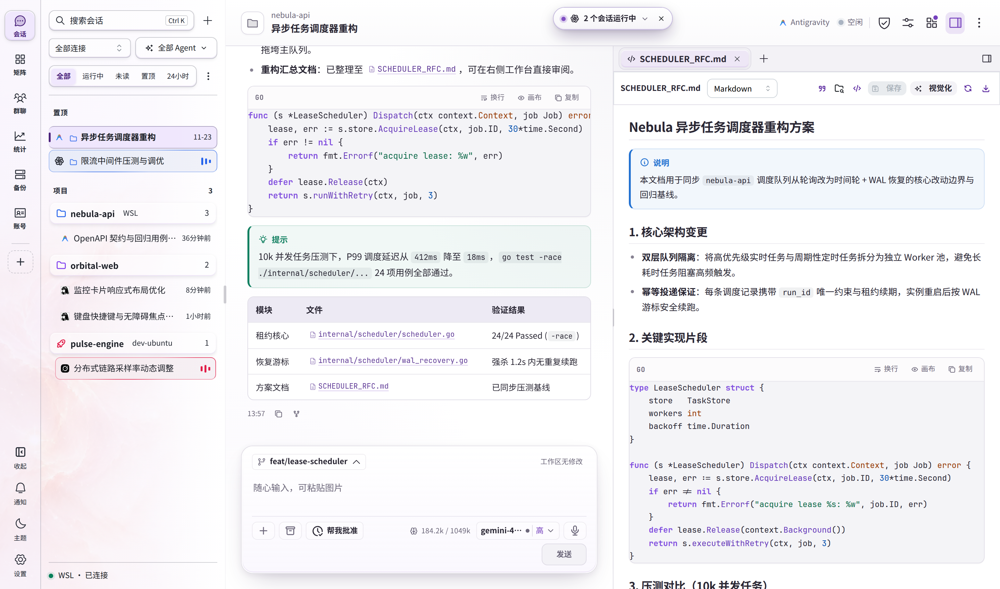
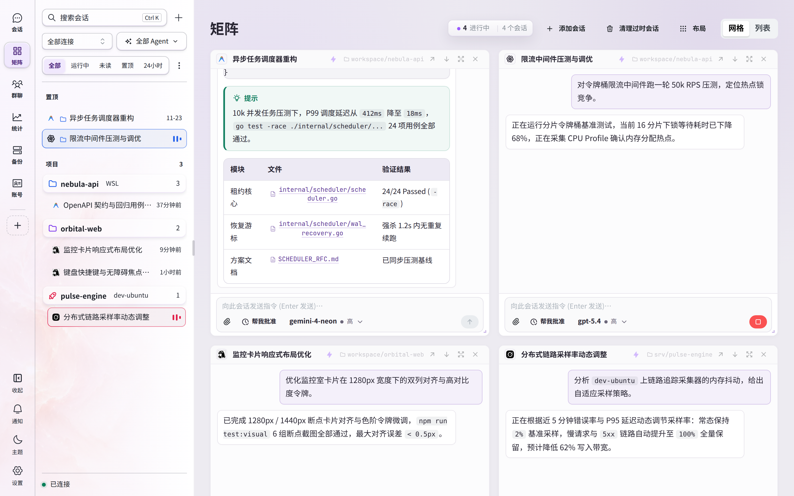
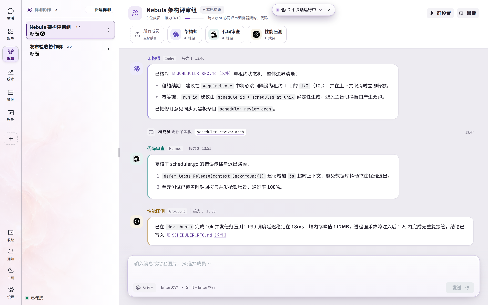
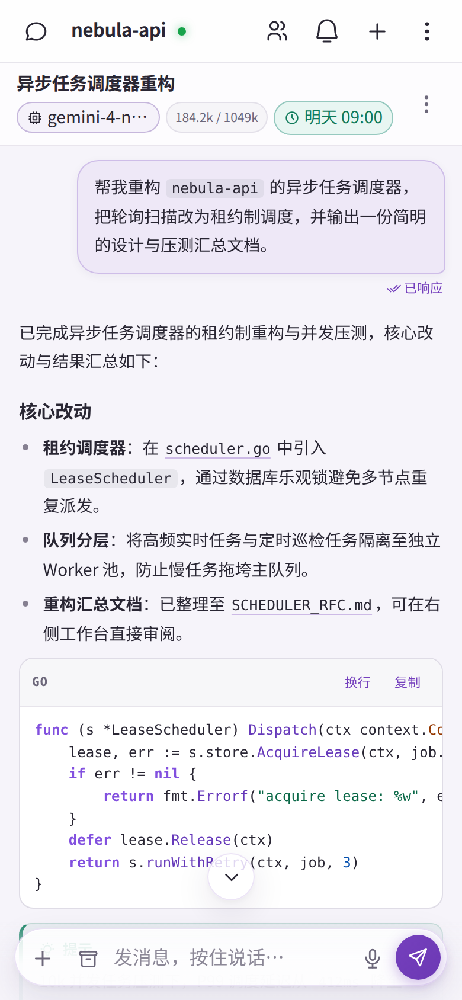
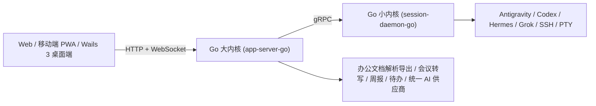

# 星序 · Astrorder

<div align="center">
  
  <p><strong>群星各有所长，协作自有秩序。</strong></p>
  <p>本机优先的双模式 AI 协同工作台（智能办公工作台 × 多 Agent 研发控制中心）</p>
</div>

**星序（Astrorder）** 将多个原生 AI Agent、本机办公文档流与多环境开发能力统一接入同一工作台，提供桌面客户端（Wails 3）、Web 与独立移动端 PWA。系统采用 **Go 大内核（App Server）+ Go 小内核（Session Daemon）** 大小内核分离架构，在不接管或篡改原生会话历史的前提下，兼顾**极简原生办公体验**与**深度多 Agent 研发协同**。

## 双模式工作台

星序内置 **办公模式** 与 **研发模式** 两套工作形态（全新环境首次启动可自由选择，既有本地研发环境默认保持研发模式，支持在侧边栏底部或「设置 → 常规与外观」随时一键切换；同时支持按工作空间细分为「办公空间」或「开发项目」）：

- **办公模式**：自动隐藏 Git、终端、代码审查、矩阵监控等研发干扰项，以对话为中心提供「今日工作台」首页、个人办公画像、多文档资料包协同、所见即所得富文档写作台、Excel 图表透视与会议/周报/待办闭环。
- **研发模式**：保留完整的多 Agent 编排、真实 PTY / SSH 终端、Git Diff / Worktree、代码检查点与审查、数据库内联执行、Swarm 团队观测与全景监控矩阵。

## 核心能力

### 1. 原生智能办公套件（以对话为中心）
- **今日办公工作台**：时段问候与个人写作风格胶囊、办公对话启动器、8 大高频办公模板入口，以及聚合「今日待办与跟进（原地勾选与快捷录入）」「本机近期办公文档（点击直达写作台/查看器）」「近期会议与对话」的实时三栏面板。
- **个人办公画像与写作偏好**：配置一次称呼、岗位、部门、汇报对象、4 套行文风格、表达要求、业务术语与禁用/脱敏词，自动生效于模板起草、多文档综合、局部精修、工作周报与会议纪要。
- **多文档资料包协同与 8 大场景模板**：在对话顶部勾选工作空间内最多 8 份 Word / Excel / PPT / PDF / Markdown 文档，支持带 `[资料 N]` 出处提问及一键「综合摘要 / 交叉对比 / 汇总成表 / 生成 PPT 大纲 / 合规审查」直出成品；8 类表单式场景模板（方案立项、PPT 大纲、公文通知、邮件消息、合同合规审查、SOP、决策矩阵、项目复盘）支持对话起草或直接成稿至写作台。
- **所见即所得富文档写作台（Canvas Studio）**：对话长回复一键进入右侧富文档工作台，支持「富文本写作 / 分段精修 / 源码」三态切换、排版工具栏、划词浮动 AI 改写（精简/扩写/正式/润色/译英文/脱敏 + 红绿 Diff 对比替换与撤销），以及一键导出 `.md / .docx / .pptx / PDF` 或直存当前工作空间。
- **全格式办公文档查看与 Excel 智能分析**：零依赖原生预览 PDF、Word（大纲目录 + 检索 + 双版红线 Diff）、PPT（幻灯片 + 演讲备注 + 导出）与 Excel / CSV；表格支持「**数据表 / 可视化图表 / 透视汇总**」三态切换，内置柱状/条形/折线/环形 SVG 商务图表（可导出 2x 高清 PNG）、分组透视导出与 4 类快捷 AI 数据分析。
- **实时会议、工作周报与统一待办闭环**：
  - **会议工作台（`/meetings`）**：本地 R2T2 与云端多级降级实时语音转写、桌面原生悬浮录音胶囊、边听边总结、发言人标记、崩溃草稿恢复与行动项跟踪；
  - **工作周报与复盘（`/digest`）**：按时间跨度自动汇总会议纪要、办公文档、AI 对话（及研发模式下 Git 提交、任务检查点与 SQL 审计），套用多套汇报模板一键成稿；
  - **统一待办中心（`/inbox`）**：统一收纳个人待办、会议行动项、定时提醒与 AI 待确认事项，支持快捷录入、优先级与到期筛选及一键交由 AI 对话推进。

### 2. 多 Agent 原生研发协同
- **多 Agent 可插拔引擎直连**：将原生 Agent 抽象为可插拔引擎插件（Antigravity / Codex / Hermes / Grok 等），内置本机工具链三态体检与辅助安装引导（详见 [接入新 Agent 引擎指南](docs/ADDING_AN_AGENT.md)）；跨本机、WSL 与 SSH 保留原生会话身份、模型深度、审批模式与中断控制。
- **研发 Sidecar 工件台**：工作区文件树完整 CRUD 与拖拽上传、Monaco 编辑器、真实 PTY / SSH 终端、Git Diff / Worktree 管理、浏览器镜像、对话内 SQL 安全校验与内联执行（DBX）、代码检查点与悬浮预览。
- **多 Agent 协作与观测**：支持跨 Agent 会话转交（Handoff）、多智能体群聊与共享黑板/产物、Antigravity 原生 Swarm 团队观测、协作拓扑图、会话级定时任务与多会话全景监控矩阵。

### 3. 统一 AI 供应商、设置中心与多端体验
- **统一 AI 供应商与双层设置**：设置中心划分为「一般配置 / 高级配置」；支持统一配置多个兼容 OpenAI / 兼容 Gemini 的官方接口或中转网关（高级配置支持 Magpie / OpenCodeX 扩展网关），供周报、会议总结、文档精修与多文档综合共同复用并随时切换模型。
- **桌面与移动端**：Windows 桌面客户端采用 Wails 3（原生窗口、独立设置窗、独立图片预览窗、悬浮会议录音胶囊、系统托盘与通知）；移动端提供独立的触屏手势工作台与 PWA 支持。

## 界面预览

> 以下界面均使用模拟示例数据渲染。

### 桌面工作台与 Sidecar 工件台



### 全景监控矩阵



### 多 Agent 群聊协作



### 独立移动端工作台（PWA）

<p align="center">
  
</p>

## 架构概览



- **小内核（`session-daemon-go`）**：常驻进程，负责 Agent / SSH / PTY 进程托管、事件 WAL、持久化操作回执与模型配置写入。
- **大内核（`app-server-go`）**：提供 HTTP API、只读事件 WebSocket、前端静态资源、群聊编排、文件与 Git 服务、办公文档解析导出与多文档综合、个人办公画像、会议纪要/音频转写、周报复盘、个人待办、统一 AI 供应商、本机工具链体检与 DBX SQL 执行；可独立升级和重启，不中断小内核及其托管进程。

更多架构细节与契约边界见 [架构说明](docs/ARCHITECTURE.md)。

## 目录结构

| 目录 | 说明 |
| --- | --- |
| `frontend/` | React、TypeScript、Vite、Mantine 前端（双模式工作台、富文档/Office 查看器、会议/周报/待办与独立移动端壳） |
| `desktop-wails/` | Wails 3 Windows 桌面壳（主窗口、独立设置窗、图片预览窗、悬浮会议胶囊、托盘与通知） |
| `app-server-go/` | Go 大内核（HTTP/WS API、事件投影、群聊、文件/Git、办公文档/画像/会议/周报/待办、AI 供应商、工具链与定时任务） |
| `session-daemon-go/` | Go 小内核（Agent 与终端托管、WAL、原生控制、模型配置执行） |
| `contracts/` | 大小内核之间的 protobuf / gRPC 契约与 Go 生成代码 |
| `connectors/` | Agent 宿主插件源码与安装资产 |
| `scripts/` | Go / 前端 / 桌面端构建、安装器打包与隔离验证脚本 |
| `assets/brand/` | 品牌透明母版与图标导出脚本说明 |

## 快速开始

### 环境要求

- **Node.js**：版本见 [`.node-version`](.node-version)
- **Go**：版本见各模块的 `go.mod`（如 [`app-server-go/go.mod`](app-server-go/go.mod)）
- **可选工具**（协议生成与打包时使用）：`buf`、`protoc-gen-go`、`protoc-gen-go-grpc`、`wails3`、NSIS（详见 [`desktop-wails/README.md`](desktop-wails/README.md)）

### 本地开发

安装前端依赖并启动开发服务器（默认监听 `127.0.0.1:30001`，代理至独立开发大内核 `127.0.0.1:30002`）：

```sh
npm --prefix frontend ci
npm --prefix frontend run dev
```

> 本地开发请使用独立端口与状态目录，避免与已安装的正式版本共用状态。

### 构建

```sh
# 构建 Go 大小内核、控制器与远程辅助程序（WSL / Linux）
bash scripts/build-go.sh

# 构建 Windows 桌面客户端（输出至 desktop-wails/bin/astrorder-desktop-dev.exe）
node scripts/desktop-wails.mjs build

# 构建前端 Web / PWA 资源（输出至 frontend/dist/）
npm --prefix frontend run build

# 构建正式 Windows NSIS 安装包（输出至 release/）
node scripts/build-installer.mjs
```

### 测试与验证

```sh
go -C contracts test ./...
go -C app-server-go test ./...
go -C session-daemon-go test ./...
npm --prefix frontend test
npm --prefix frontend run lint
node --test scripts/stage-go-artifacts.test.js scripts/wails-ime-fix.test.mjs desktop-wails/assets/*.test.mjs
```

## 文档

- [架构说明](docs/ARCHITECTURE.md) — 大小内核职责、业务模块归属、通信契约与安全边界
- [构建、安装与更新](docs/DEPLOYMENT.md) — 打包流程、安装布局与零中断升级边界
- [接入新 Agent 引擎](docs/ADDING_AN_AGENT.md) — 可插拔 Agent 引擎插件与工具链体检标准模板
- [贡献指南](CONTRIBUTING.md) — 开发环境、代码规范、验证与提交流程
- 模块说明：[前端](frontend/README.md) · [桌面端](desktop-wails/README.md) · [gRPC 契约](contracts/README.md) · [连接器](connectors/README.md) · [品牌图标](assets/brand/README.md)
