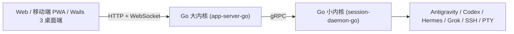

# 星序 · Astrorder

<div align="center">
  
  <p><strong>群星各有所长，协作自有秩序。</strong></p>
  <p>本机优先的多 Agent 协同控制工作台与工件处理中心</p>
</div>

**星序（Astrorder）** 将多个原生 Coding / CLI Agent 统一接入同一工作台，提供桌面客户端（Wails 3）、Web 与独立移动端 PWA。它采用 **Go 大内核（App Server）+ Go 小内核（Session Daemon）** 大小内核分离架构，在不接管或篡改原生会话历史的前提下，实现跨本机、WSL 与 SSH 环境的会话托管、文件工作台、群聊协作与运行观测。

## 核心能力

- **多 Agent 原生直连**：原生接入 Antigravity（agy）、Codex、Hermes、Grok，以及 WSL / SSH 远程环境；保留原生会话身份、历史、模型与思考深度、审批模式与中断控制。
- **项目与工作台（Sidecar）**：按项目组织会话，右侧提供工作区文件树、Monaco 代码编辑、真实 PTY / SSH 终端、Git Diff、浏览器镜像、Markdown / 图片 / 流程图预览与代码链接悬浮预览。
- **多 Agent 协作**：支持跨 Agent 会话转交（Handoff）、多智能体群聊与共享黑板/产物、Git Worktree 分叉、Antigravity 原生 Swarm 团队观测与会话级定时任务。
- **矩阵监控与统计**：统一观测运行中与待审批会话，追踪模型网关用量、账号额度与备份恢复。
- **桌面与移动端**：Windows 桌面客户端采用 Wails 3（原生窗口、系统托盘、通知与图片预览）；移动端提供独立的触屏手势工作台与 PWA 支持。

## 界面预览

> 以下界面均使用模拟示例数据渲染。

### 桌面工作台与 Sidecar 工件台


### 全景监控矩阵


### 多 Agent 群聊协作


### 独立移动端工作台（PWA）

<p align="center">
  
</p>

## 架构概览



- **小内核（`session-daemon-go`）**：常驻进程，负责 Agent / SSH / PTY 进程托管、事件 WAL、持久化操作回执与模型配置写入。
- **大内核（`app-server-go`）**：提供 HTTP API、只读事件 WebSocket、前端静态资源、群聊编排、文件与 Git 服务；可独立升级和重启，不中断小内核及其托管进程。

更多架构细节与契约边界见 [架构说明](docs/ARCHITECTURE.md)。

## 目录结构

| 目录 | 说明 |
| --- | --- |
| `frontend/` | React、TypeScript、Vite、Mantine 前端与独立移动端壳 |
| `desktop-wails/` | Wails 3 Windows 桌面壳（窗口、托盘、通知、图片预览） |
| `app-server-go/` | Go 大内核（HTTP/WS API、事件投影、群聊、文件/Git、定时任务） |
| `session-daemon-go/` | Go 小内核（Agent 与终端托管、WAL、原生控制、模型配置执行） |
| `contracts/` | 大小内核之间的 protobuf / gRPC 契约与 Go 生成代码 |
| `connectors/` | Agent 宿主插件源码与安装资产 |
| `scripts/` | Go / 前端 / 桌面端构建、安装器打包与隔离验证脚本 |
| `assets/brand/` | 品牌透明母版与图标导出脚本说明 |

## 快速开始

### 环境要求

- **Node.js**：版本见 [`.node-version`](.node-version)
- **Go**：版本见各模块的 `go.mod`（如 [`app-server-go/go.mod`](app-server-go/go.mod)）
- **可选工具**（协议生成与打包时使用）：`buf`、`protoc-gen-go`、`protoc-gen-go-grpc`、`wails3`、NSIS（详见 [`desktop-wails/README.md`](desktop-wails/README.md)）

### 本地开发

安装前端依赖并启动开发服务器（默认监听 `127.0.0.1:30001`，代理至独立开发大内核 `127.0.0.1:30002`）：

```sh
npm --prefix frontend ci
npm --prefix frontend run dev
```

> 本地开发请使用独立端口与状态目录，避免与已安装的正式版本共用状态。

### 构建

```sh
# 构建 Go 大小内核、控制器与远程辅助程序（WSL / Linux）
bash scripts/build-go.sh

# 构建 Windows 桌面客户端（输出至 desktop-wails/bin/astrorder-desktop-dev.exe）
node scripts/desktop-wails.mjs build

# 构建前端 Web / PWA 资源（输出至 frontend/dist/）
npm --prefix frontend run build

# 构建正式 Windows NSIS 安装包（输出至 release/）
node scripts/build-installer.mjs
```

### 测试与验证

```sh
go -C contracts test ./...
go -C app-server-go test ./...
go -C session-daemon-go test ./...
npm --prefix frontend test
npm --prefix frontend run lint
node --test scripts/stage-go-artifacts.test.js scripts/wails-ime-fix.test.mjs desktop-wails/assets/*.test.mjs
```

## 文档

- [架构说明](docs/ARCHITECTURE.md) — 大小内核职责、通信契约与安全边界
- [构建、安装与更新](docs/DEPLOYMENT.md) — 打包流程、安装布局与零中断升级边界
- [贡献指南](CONTRIBUTING.md) — 开发环境、代码规范、验证与提交流程
- 模块说明：[前端](frontend/README.md) · [桌面端](desktop-wails/README.md) · [gRPC 契约](contracts/README.md) · [连接器](connectors/README.md) · [品牌图标](assets/brand/README.md)
