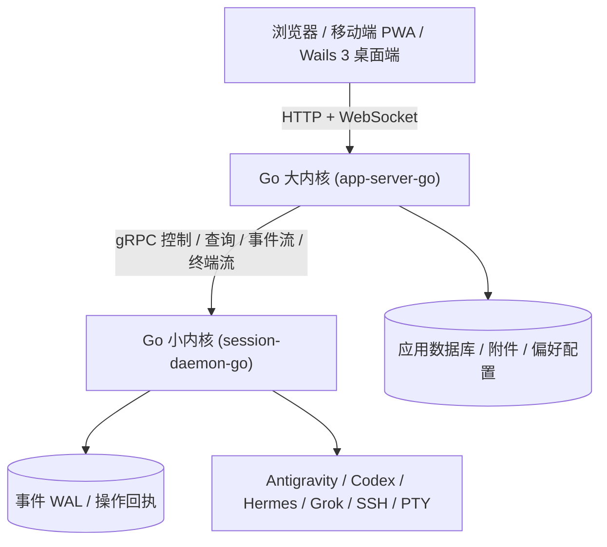

# 架构说明

星序（Astrorder）采用 **大小内核分离架构（Dual-Kernel Architecture）**：业务大内核（Go App Server）与常驻小内核（Go Session Daemon）作为独立进程运行，通过本机 protobuf/gRPC 通信；Web、移动端 PWA 与 Wails 3 桌面端共享同一套 React 前端。

## 1. 分层与模块归属

| 层次 | 核心职责 | 目录 |
| --- | --- | --- |
| 客户端 UI | 会话与项目导航、消息渲染、工作台 Sidecar、群聊、矩阵监控、移动端壳 | `frontend/` |
| 桌面壳 | 原生窗口、系统托盘、通知、文件选择、独立图片预览、服务控制入口 | `desktop-wails/` |
| 业务大内核 | HTTP/WS API、鉴权、SQLite 产品数据、事件投影、群聊编排、定时任务、文件/Git 与辅助集成 | `app-server-go/` |
| 常驻小内核 | Agent / SSH / PTY 进程托管、原生控制、事件 WAL、持久化操作回执、模型配置执行 | `session-daemon-go/` |
| 内核契约 | protobuf 消息、gRPC 服务定义、流协议与生成代码 | `contracts/` |
| 宿主插件 | Codex / Hermes 宿主插件源码与安装资产 | `connectors/` |

## 2. 独立故障域与生命周期

- **进程解耦**：所有 Agent 运行时、SSH 连接和交互终端进程由小内核托管。大内核或桌面客户端重启、升级时，小内核及其托管的子进程持续运行，不中断正在进行的会话。
- **可恢复的事件投影**：大内核重连小内核后，按已确认的事件序列（durable cursor）结合快照、重放与实时事件流恢复状态；不因为重连而重放结果不确定的写命令。
- **受控服务管理**：`astrorderctl` 通过可执行路径、PID、创建时间与端口归属校验服务身份。大内核与桌面端可独立更新；小内核更新仅暂存候选文件，由用户手动激活（见[构建、安装与更新](DEPLOYMENT.md)与 [`AGENTS.md`](../AGENTS.md)）。

## 3. 通信契约与权威来源

各通道采用独立身份与鉴权边界，避免在文档中重复抄写易过期的接口定义，统一以源码为权威来源：

| 通道 / 内容 | 权威维护位置 |
| --- | --- |
| HTTP 路由与处理器（`/api/v1`） | `app-server-go/internal/httpapi/` 及各业务子包 |
| OpenAPI 公开定义 | `app-server-go/internal/httpapi/openapi.json`（运行期可访问 `/openapi.json` 与 `/docs`） |
| 前端 API 客户端与领域类型 | `frontend/src/api/client.ts`、`frontend/src/domain/types.ts` |
| 浏览器只读事件流（`/ws/v1/events?after={cursor}`） | `app-server-go/internal/application/eventhub.go`、`frontend/src/api/eventStream.ts` |
| Agent CLI / 能力目录与鉴权 | `app-server-go/internal/agentapi/` |
| 大小内核 gRPC 协议 | `contracts/proto/astrorder/sessiond/v1/sessiond.proto`（详见 [`contracts/README.md`](../contracts/README.md)） |

核心契约原则：

- 浏览器写操作一律通过 HTTP 提交，WebSocket 仅用于只读事件推送与按游标断线重放。
- 收到命令受理或排队回执不代表模型已完成本轮执行，最终状态以事件与消息投影为准。
- 大小内核间严格使用强类型 protobuf RPC，不提供通用 JSON 方法转发；原生扩展字段通过 `NativeJson` 保留原始字节与精确数字。

## 4. 数据与安全边界

- **原生身份隔离**：会话以 `agent_id + session_id` 唯一定位，原生历史由底层 Agent 运行时持有；大内核只保存投影、偏好、群聊、黑板、定时任务与附件等产品数据。
- **跨环境路径归属**：本机、WSL 与 SSH 路径必须连同连接来源（`connection_id`）解析；所有文件读写和命令执行均受会话工作区边界校验约束。
- **凭据隔离**：浏览器会话、Agent 能力入口、连接器与内核 gRPC 使用各自独立的认证机制；SSH 私钥仅保存路径引用，日志与文档中禁止记录令牌、Cookie 或密钥。

> 注：`docs/reports/` 目录仅保留供契约测试与 `astrorderctl` 兼容性校验读取的冻结基线数据，不属于日常阅读文档。
