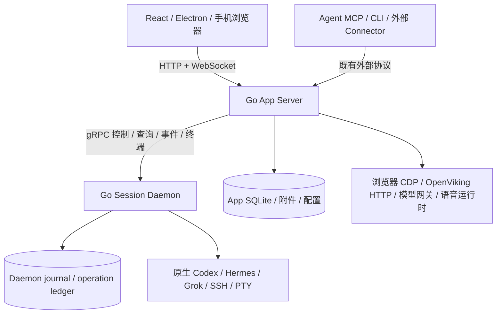

# 星序全 Go 后端迁移实施与验收规范

> 本文是交给执行模型的完整任务书。允许分阶段实现、审查和发布；最终交付必须是 Go App Server + Go Session Daemon，不能停在 gRPC 接通、Go 代理 Python 或部分路由迁移。
>
> 执行模型逐项提供证据，后续由独立审查模型复核。本文仅制定方案，不代表已执行迁移，也不授权中断生产会话。

## 1. 最终目标与完成定义

### 1.1 必须达到的最终状态

1. **大内核完整 Go 化**：星序 App Server 的 HTTP API、WebSocket、鉴权、事件投影、应用数据持久化、任务编排、浏览器自动化、配置管理、语音服务管理、Agent API/MCP/CLI 均由 Go 实现。
2. **小内核保持 Go**：继续使用 `session-daemon-go/` 中的 runtime、journal、events、modelconfig；新增 gRPC 传输适配，不复制第二套小内核。
3. **内核间使用 gRPC**：控制、查询、重放、实时事件、终端数据传输有明确 protobuf 契约。旧的内部 WebSocket/JSON IPC 在迁移结束时移除。
4. **前端与产品能力保持等价**：React/Electron 保留。既有 HTTP 路径、浏览器 WebSocket、MCP 工具名称、CLI 使用方式、事件含义和用户数据保持兼容，除非用户单独批准产品变更。
5. **运行、安装、升级不依赖星序 Python 后端**：安装包不携带 App 的 Python 解释器、venv、FastAPI/SQLAlchemy 服务或常驻 Python worker；启动、停止、状态、凭据初始化、开机启动、同步发布均有 Go 入口。
6. **数据保留**：正式 App 数据库、附件、偏好、连接配置、模型绑定、审批、操作回执及 daemon checkpoint 能继续使用；Agent 原生历史仍是其权威来源。
7. **生产完成切换**：在满足第 13 节的授权与状态约束后，正式安装版运行 Go 大内核；只重启大内核不会重启小内核或中断其托管会话。
8. **清退完成**：删除被替代的 Python App 实现、临时代理、Python gRPC 客户端和旧内部 IPC。Git 检查点用于历史追溯，不在工作树保留旧后端副本。

### 1.2 “全 Go”的范围解释

| 对象 | 最终要求 |
| --- | --- |
| Astrorder App Server / Session Daemon / 服务管理 CLI | Go；不得通过 `python -c`、嵌入解释器或 sidecar 执行业务逻辑 |
| React、Electron、浏览器扩展 | 继续 TypeScript/JavaScript；不要求改写桌面框架 |
| Codex、Hermes、Grok、OpenViking、llama.cpp、Git、SSH、浏览器 | 外部工具保持原有实现语言和协议；不重写这些产品 |
| Hermes 等原生插件必须在 Python 宿主加载的轻量代码 | 可以保留为 **Agent 安装资产**，仅桥接宿主 API、通知、配置；不得承载 App 数据库、HTTP 服务、业务编排或替代 Go 实现 |
| 星序自有 Codex observer hook、通用 CLI/MCP bridge、远程文件和配置脚本 | 能作为独立程序运行的逻辑迁到 Go；仅因现实现是 Python 不构成豁免 |
| `jev_ultrafast` / `browser-harness` 等 App 侧 Python 依赖 | 必须消除运行时依赖，保留实际使用能力；不能以独立 Python 浏览器服务作为最终交付 |
| 开发期对照测试、历史报告、非发布必需的离线素材工具 | 可留，必须列出非运行依赖；最终构建、安装和必要验收工具不依赖旧 Python App |

不能以“机器上 Hermes 本来需要 Python”为理由继续依赖 Python 大内核。最终无 Python 环境验收针对星序控制面；需要 Python 的原生 Hermes 使用其自身环境，并单独验证插件接入。

### 1.3 交付状态不可混用

- `IMPLEMENTED`：代码落地，尚不代表行为已验证。
- `ISOLATED_VERIFIED`：在隔离进程、端口和数据库上通过契约与集成验收。
- `REVIEWED`：独立审查通过，发现的问题已修复并复验。
- `PRODUCTION_VERIFIED`：正式安装版切换并完成真实读回。
- `DONE`：全部必需项达到最终状态，旧实现与临时路径已清退。
- `BLOCKED`：缺环境、凭据、授权或依赖，必须写明哪项验收未完成；不能计作通过。

阶段完成不等于整个项目完成。若生产授权未取得，可以报告“候选版验收完成、待生产切换”，不能报告“全 Go 迁移完成”。

## 2. 已核实的基线

文档基于仓库提交 `ff32f947024b1840b939ebfb8e58e45886d34b47` 编写。开始执行时重新核对 HEAD 与工作区；新增功能也要进入迁移矩阵，不能因不在本次清单而丢失。

- Go 小内核实现位于 `session-daemon-go/`，当前使用 WebSocket + JSON；`go.mod` 尚无 gRPC 依赖。
- Python 小内核已删除；`backend/src/astrorder/daemon/` 只包含 App bridge、投影与 `clients/`。
- Python 大内核基于 FastAPI、SQLAlchemy、SQLite；入口是 `main.py`，并非只有 `routers/`。
- 静态 AST 扫描发现 **167 个 HTTP/WebSocket 装饰器声明**，其中 `api.py` 72 个、`main.py` 7 个。这个数字是定位线索，不是最终运行路由数：必须合并 APIRouter 前缀、include 关系及动态注册后生成清单。
- `models.py` 声明的表：`workspace_preferences`、`agents`、`agent_connection_choices`、`sessions`、`projects`、`attachments`、`messages`、`commands`、`tasks`、`ssh_connections`、`connection_history`、`review_relay_bindings`、`review_relay_runs`、`events`、`daemon_checkpoints`、`token_metrics`。还需扫描 Store 内 SQL、动态迁移及插件额外表。
- `agents/gateway.py` 的能力目录与 `agents/mcp.py` 的工具映射是对外契约，不可只扫描 HTTP 路由。
- `desktop/main.js` 通过 Python 调用 `desktop_service.py`、`provision_desktop.py`、`print_browser_token.py`；`desktop/package.json` 打包整个 backend，`frontend/package.json` 的 sync/build:sync 仍调用 Python。
- `jev/browser.py` 直接导入 `jev_ultrafast`；`plugins/r2t2.py` 管理 llama.cpp 本地进程。两者都不能遗漏。
- `core/skills_sync.py`、`ov_sync.py`、`capabilities_sync.py`、`capabilities_dispatch.py`、`ssh_transport.py` 中存在远程 Python 命令。
- 上一阶段清理验收：后端 483 passed、2 skipped；Go 275 passed、build/vet 通过。它们只是已记录的历史结果，不证明本次迁移代码正确，也不是以后必须保持的测试数量。
- `session-daemon-go/internal/parity/manifest.json` 的来源提交早于本基线，不能直接当作完整清单；需从当前 handlers、App 调用及真实测试补齐，例如操作回执查询。

主要现有证据入口：`docs/session-daemon.md`、`docs/design/session-daemon-go-rewrite.md`、`docs/reports/session-daemon-go-acceptance.md`。历史设计与当前代码冲突时，以实际行为和本次明确目标核对，不复制已过时的 Python 小内核方案。

## 3. 固定架构与范围



### 3.1 必须维持的边界

- 大小内核是两个独立失败域；同为 Go 不意味着合并为一个进程。
- 大内核负责产品 API、应用投影、用户偏好、配置计划、辅助集成；小内核负责既有托管会话与进程、原生控制、WAL、模型配置执行。
- 不把文件/Git、黑板、统计、记忆展示全部塞入小内核；App 内部模块用普通 Go 调用，不拆成额外微服务。
- 不重写现有 Go runtime、WAL、持久操作账本，不更换 SQLite 为另一数据库，不引入消息队列、Kubernetes、服务发现或分布式调度。
- 保留前端对外 HTTP/JSON 与 WebSocket；不引入 gRPC-Web，不要求用户界面随内部协议重做。
- 不把 Agent 的模型调用改成星序代理。OpenViking 保持 Agent 直连 + 星序配置下发与展示。
- 既有 App 原生读库/外部会话观察功能必须分类迁移；“进程托管已在 Go”不代表这些功能可以删除。

### 3.2 拟新增目录（均为规划产物，当前未实现）

```text
contracts/
  go.mod
  proto/astrorder/sessiond/v1/sessiond.proto
  gen/go/astrorder/sessiond/v1/
  buf.yaml
  buf.gen.yaml
app-server-go/
  go.mod
  cmd/astrorder-app/main.go
  cmd/astrorderctl/main.go
  internal/httpapi/
  internal/auth/
  internal/config/
  internal/store/
  internal/daemonclient/
  internal/projection/
  internal/sessions/
  internal/connections/
  internal/agentapi/
  internal/integrations/
  internal/lifecycle/
  internal/migrationproxy/       # 临时，最终必须删除
  internal/parity/
  internal/acceptance/
session-daemon-go/
  internal/grpcapi/             # 新传输，调用现有内核行为
  internal/protocol/            # 逐步分离共享逻辑与旧 WS 适配
backend/src/astrorder/daemon/
  grpc_client/                 # 临时 Python 生成代码/适配，最终删除
scripts/build-go.ps1
scripts/build-go.sh
```

两个应用 module 依赖一个只包含协议生成代码的 `contracts` module，通过固定的本地 replace 或 workspace 管理；锁定生成器版本。不要让 App 导入 daemon 的 `internal/` 包，不建共享的业务模型大包。目录可在实现时精简，但新增/改名必须同步本文和验收入口，不产生同职责的平行框架。

## 4. 执行模型工作规则

> 执行顺序调整（用户明确指令）：优先完成完整重构与实际集成，模块必须接入正式路由、数据层、事件链路和启动入口。开发期保留必要编译、相关测试与链路自测，数据安全或正确性缺陷及时修复；暂停扩展验收框架、台账校验器和报告格式，非阻塞问题集中记录。功能全部接通后，再统一进行全量回归、多环境真实链路验证、独立审查与缺陷修复。本文逐子任务独立审查、完整证据和重复全量构建的流程要求由此覆盖，不作为继续开发的门槛；最终功能与质量标准、生产切换和小内核重启授权约束保持有效。

1. 从第 8 节的依赖顺序执行。开始一个子任务前读其源代码、调用者、现有测试和数据归属，不凭文件名推断行为。
2. 每次只交付一个可验收行为：记录旧行为 → 编写能失败的回归 → 实现 → 验证 → 更新证据。不要一次机械翻译整库。
3. 所有迁移项必须有源实现、调用入口、新实现、数据写入者、测试和状态。未映射项即未完成。
4. 不以空数组、固定成功、伪造工具结果、吞错误或永久 501/503 替代实现。运行时依赖缺失可以明确报错，但已支持能力未迁移仍属于缺口。
5. 不删除失败测试来通过验收。旧实现专属测试可以替换，但每个产品行为断言必须映射到新测试。
6. 不允许“Go API 调用旧 Python 函数”作为阶段最终成果；临时代理只允许出现在明确标记的过渡阶段。
7. 不做静默协议回退：gRPC 失败就返回准确错误，不能偷偷改用旧 WS 或重新提交命令。
8. 不自动重发结果不确定的原生命令；不通过连接探测创建隐藏对话或发送 hello 提示词。
9. 任何运行时 ID、Agent ID、connection ID、原生 session ID、审批 ID、operation ID 原样保留；禁止按标题、时间或文本猜测关联。
10. 修改公共签名后检查所有调用者，包含生产、桌面、登录启动、测试与打包命令。之前的 `root` 参数遗漏是必须防止再次出现的回归。
11. “可编译”“模块单测通过”“隔离协议测试通过”“真实 Agent 验收”“生产已切换”分别报告。禁止合并为一句“全部通过”。
12. 不擅自增加八小时长稳、跨平台桌面重写、透明进程接管等新目标。发现问题分为迁移回归、既有缺陷、环境问题、可选增强；有限验收矩阵不能无限增长。
13. 不读取或打印生产密钥、聊天正文与私钥。取证记录 ID、状态、脱敏摘要、文件哈希、计数与构建版本。
14. 用户当前授权是编写和后续执行迁移方案的讨论；本文不自动授予提交推送、真实收费调用或生产停机权限。沿用具体执行会话中的实际授权，不重复索要已经明确给出的许可。

## 5. gRPC 契约：实现前必须固定

### 5.1 服务划分

建议在 `astrorder.sessiond.v1` 中采用以下明确服务，服务内 RPC 名称在 P1 固定后不得随意漂移：

| 服务 | 必须覆盖的职责 | 调用形式 |
| --- | --- | --- |
| DaemonControl | 版本/能力、权威状态、受保护停止 | unary |
| SessionControl | 创建/绑定、发送、steer、review、compact、interrupt、approve、设置、删除、重命名、关闭 | unary，长操作返回操作标识并查询结果 |
| RuntimeQuery | 原生目录、分页历史、模型/推理/审批读写、命令/mentions、连接/断开 | unary 或有界分页 |
| EventStream | 从持久游标恢复至实时事件 | server streaming |
| TerminalStream | 终端输入、输出、尺寸变更、明确关闭 | bidi streaming |
| OperationQuery | durable operation 状态和已完成回执 | unary |
| ModelConfig | plan/apply/reload，沿用既有 executor | unary + 操作查询（现有异步语义按实际映射） |
| ConnectorIngress | App 上的外部 Connector 向 daemon 注入身份、事件、绑定与断连 | 明确的 unary/stream RPC；不得借遗留内部 WS 完成 |

这张表不是路由完整性证明。P0 中每一个现有 action 都必须映射至方法或 protobuf `oneof` 分支，包括后台维护、观察状态、session.event 等内部生产者路径；外部 Connector 的 WebSocket 协议可以保留。

### 5.2 字段、版本与错误

- 星序自有身份、命令、分页、状态、审批、错误和事件信封必须有类型；不能仅做 `Call(action, json)` 然后宣布完成 gRPC。
- Agent 原生扩展负载可用带类型标记的 JSON `bytes`，保留大整数与未知字段。不要用 `google.protobuf.Struct` 浮点数字承载 seq_id 或原生大整数。
- 需要区分缺省、空字符串、false、0、null 的字段使用 `optional`/`oneof` 或明确 presence。HTTP 输出继续符合原契约，不能让 protojson 自动变更 int64、枚举或 null 语义。
- 保留 `daemon_id`/epoch、agent_id、connection_id、session_id、operation_id、seq_id；seq_id 为 int64。多源相同原生 session ID 不得合并。
- protobuf 删除字段时 reserve 编号与名称；包版本用于明确不兼容变更。启动时校验双方协议版本/能力，不匹配要清楚失败。
- 错误区分参数无效、未认证、无权限、未找到、状态前置条件不满足、容量不足、临时不可用、超时、内部失败；HTTP 状态码和错误体保持既有对外行为。
- 传输失败与业务执行结果分离。`DeadlineExceeded` 不等于操作未执行；保留 `pending/uncertain/completed` 等真实回执语义。
- 生成 Go/Python 客户端，生成命令与版本写入 build 脚本；重复生成无 diff。Python 生成物在 Python App 删除时一并清退。

### 5.3 重放与实时交接

采用一个订阅请求携带各会话 checkpoint，流内明确发送 snapshot/replay/live-ready/live 事件类型，避免客户端自行拼接无屏障的两个请求。服务器内部仍使用现有有界 journal 读取能力，不加载全部历史。

必须满足：

1. 先建立受控订阅再取得状态快照，覆盖状态查询与重放之间新建会话/新事件。
2. 为已知会话固定 committed 高水位，按该边界完成历史重放；边界后事件进入实时区间。
3. 历史未结束前不发 live-ready；新会话和重放期间事件不能遗漏或重复提交。
4. App 只有成功提交投影和对应 checkpoint 后才视为消费成功；应在同一数据库事务内完成，做不到时必须以幂等键和崩溃测试证明等价效果。
5. 相同事件重复到达可幂等处理；不同 session/Agent 的相同 seq 不相互去重。
6. 超过保留窗口明确返回需要重新同步，不能悄悄跳到最新 checkpoint。
7. 慢消费者使用有界队列；溢出或发送超时明确终止订阅，让客户端从持久 checkpoint 恢复。gRPC 流控不替代业务队列上限。
8. daemon epoch 改变时检查身份与所有权丢失事件；禁止沿用旧 epoch 游标误认新内核历史。
9. App 断开、流取消或重启只释放订阅；不得停止托管 Agent。用户 interrupt/close 只能通过显式业务命令触发。
10. 不假设 unary 响应与独立事件流有全局顺序；用 operation/turn/event 标识关联，允许先见事件后见调用回执。

### 5.4 幂等与持久化兼容

- 复用 Go 现有操作账本。P0 核对哪些命令已持久去重，哪些是只读；新增传输不得缩小保护范围。
- gRPC 与旧 WS 暂时并存时，相同操作必须使用相同的规范化业务负载和 scope。排除传输 request ID，但不能随意排除业务字段。
- protobuf 默认值/字段顺序不能改变既有操作哈希。用旧版本创建 completed 和 uncertain 记录，新版本读回、重试，确认不误判冲突、不重复执行；必要的哈希版本迁移必须有明确识别，不能清库。
- 同一 operation_id 配不同 payload 拒绝；uncertain 禁止自动重新派发；completed 返回存储回执。
- 不将 daemon 的 runtime 生命周期 context 挂在单次 gRPC context 上。请求断开后是否取消尚未受理的工作要明确定义，已受理工作遵循原有持久状态。
- 第一阶段不改 journal 的存储格式。若确实必须修改，单独提交兼容迁移与恢复测试，禁止作为 protobuf 顺带调整。

### 5.5 安全、端口与负载

- 生产内部 gRPC 默认绑定 loopback，使用独立 daemon credential 在 metadata 鉴权；全部 unary 与 stream 都校验。浏览器、Connector、daemon 凭据不混用。
- 开发临时监听地址显式配置；生产迁移期 WS 与 gRPC 使用不同且已检查可用的端口。不得擅占一个看似空闲的固定端口；最终 production.json 明确保存唯一内部 gRPC target。
- 如果未来直接暴露非 loopback，必须先设计 TLS 和访问控制；本次无需扩成远程 gRPC 集群。
- IPC 凭据不得继承给 PTY、Agent 工具或日志。保留现有平台凭据加密，Windows DPAPI 用 Go 调用系统 API。
- 当前 WS 接收上限为 16,000,000 字节；新端到端传输必须支持原先合法最大业务负载，并为 protobuf 信封预留空间。客户端和服务端同时显式设置限制，不能依赖较小默认值。超限有明确错误、无部分派发。
- 终端按有界 bytes chunk 传输，保留 UTF-8 分片与二进制语义；不要强制每块都是完整 Unicode 文本。
- 日志记录方法、脱敏身份、操作状态、错误和耗时，不记录完整 prompt、附件、音频或凭据。

## 6. 数据与过渡期单写者规则

### 6.1 三类数据权威

| 数据 | 权威写入者 |
| --- | --- |
| Agent 原生历史、模型实际值、原生审批 | 对应原生 Agent；通过已有控制/只读历史接口访问 |
| daemon WAL、运行所有权、操作账本 | Go Session Daemon |
| App 目录、投影、偏好、用户配置、产品任务记录 | 当期指定的唯一 App 业务写入者 |

不得直接从 App SQL 修改 daemon 数据库。不得为绕过原生限制复制一份可写历史。禁止让 Go/Python 同时运行同一事件投影、自动连接恢复、observer、群聊调度或配置任务。

### 6.2 渐进迁移方式

1. Go App 先作为公共入口，Python 退到只允许本机访问的私有端口。前端地址保持稳定。
2. 维护显式“HTTP 方法 + 路径/前缀 + WebSocket 路径”的路由所有权清单；迁移完成路由只走 Go，未迁移才代理 Python。
3. 代理不能先尝试 Go 后根据错误 fallback Python，尤其不得重复 POST。正确转发认证、流式响应、WebSocket Upgrade、取消、状态码和头部，不缓冲整个流。
4. 独立只读功能可以先切；写功能必须连同所需表/偏好键域、后台任务和事件生产者确定唯一归属。
5. 共享 `workspace_preferences` 等表按 key namespace 记录写入者；无法隔离的交叉事务模块一起迁移。
6. 过渡期所有产品事件仍由唯一 App 事件写入者分配 cursor 并广播。Go 新写路由如需发事件，调用私有受认证的单一事件提交入口，并使用稳定幂等键；本地业务写入与发布之间若可能丢事件，使用可重试的持久待发布记录，不能靠内存队列。此临时桥在事件所有权切换后删除。
7. 两边共存期间只有一个 schema migrator；其他进程只校验版本。避免两个 ORM 启动时自动改表。
8. 会话核心阶段将 Store 会话写入、daemon 投影、App 事件中心、命令调度、连接恢复作为一个迁移组，先停旧 App 消费者再启新消费者。这个操作不要求停止 daemon；未消费事件由其保留与重放恢复。
9. 临时私有端口只接受受认证调用；不得因此绕过用户原有权限或暴露额外 LAN 服务。最终不存在 Python upstream、兼容代理或私有事件桥。

### 6.3 SQLite 与配置迁移验收

- 使用 SQLite backup API 或停止相应写入者后取得一致备份；不能只拷贝正在 WAL 模式写入的主 db 文件。
- 对照源实现中的表、索引、唯一约束、默认值、JSON 编码、时间戳、排序、分页、null 与空值。保留复合身份，例如 session 的 agent_id + id。
- 每个连接启用所需 foreign_keys、WAL 和 busy_timeout；当前 App busy_timeout 为 30000ms。写入并发策略明确，测试事务失败不产生半条消息或推进 checkpoint。
- 旧库升级测试至少包含：现存会话、历史与附件、连接、偏好、模型 provider/model/effort、待审批、队列命令、review 绑定、token metrics、checkpoint。
- 新库初始化与旧库升级走同一版本管理。迁移中断后可再次执行，不重置已有设置，不重新生成可用凭据，不隐式清空队列。
- 当前 production.json 中合法用户配置保留；DPAPI 加密数据用同用户上下文解密测试，再读回比较值（只报告一致与否）。新安装不得硬编码当前开发者用户名、盘符、LAN 地址或 workspace。
- 回退不得用旧备份覆盖切换后新产生的真实消息。优先二进制回退并验证 schema 兼容；不兼容时停止切换并制定保留增量的恢复步骤。

## 7. 必迁功能矩阵

以下是最低范围；P0 扫描发现的新入口必须补入机器可检查清单。表中路径均以 `backend/src/astrorder/` 为根，除非写明其他根。

| ID | 功能域与源入口 | 必须保留的行为 | 现有测试线索 |
| --- | --- | --- | --- |
| F01 | `main.py`、`config.py`、`routers/auth.py`、`core/auth.py` | bootstrap、健康、cookie/token、Origin/LAN、静态文件缓存、SPA、desktop shutdown、服务状态 | `test_bootstrap.py`、`test_control_server.py`、`test_daemon_config.py` |
| F02 | `models.py`、`store.py`、`repositories/`、`core/workspace_preferences.py` | 全表与键域、事务、排序、游标、偏好导入、连接历史 | `test_workspace_preferences.py`、`test_message_pagination.py`、`test_connection_history*.py` |
| F03 | `daemon/bridge/`、`daemon/clients/`、`core/events.py` | Codex/Hermes/SSH 投影、完成/压缩/审批、重放、幂等、实时与历史一致 | `test_daemon_*projection.py`、`test_daemon_bridge*.py`、`test_go_daemon_*integration.py` |
| F04 | `api.py` 会话/项目入口、`native/`、`service.py`、`adapters/` | 创建、发送、队列编辑/删除/立即发送、steer/review/compact、interrupt、审批、临时会话、rename/delete/batch-delete、fork/handoff、任务和模型绑定 | `test_native_*.py`、`test_fork_session.py`、`test_handoff*.py`、`test_sidechat_fork.py`、`test_session_*.py`、`test_project_delete.py` |
| F05 | `connections.py`、`core/environment_connections.py`、`core/system_environment.py`、`ssh_transport.py`、`routers/agents.py` | 本机/WSL/Debian 的发现、连接、断开、恢复、配置更新、升级预检、外部会话目录 | `test_connections.py`、`test_environment_*.py`、`test_daemon_ssh*.py`、`test_local_hermes_workspace.py` |
| F06 | `main.py` 三个 `/ws/v1/*`、`core/terminal_service.py`、`runtime.py` | Connector 接入、事件订阅、PTY 输入输出/resize/关闭、浏览器重连、独立 daemon 托管 | `test_connector_*.py`、`test_daemon_terminal*.py`、`test_terminal_service.py` |
| F07 | `routers/files.py`、`routers/git.py`、`routers/attachments.py`、`core/attachments.py`、`core/staging_files.py`、api.py 文件操作 | 本地/远端文件树、搜索、mkdir、stage、raw、open/write、上传下载、Git status/diff/branch；路径与工作区权限 | `test_file_tree.py`、`test_git_status_api.py`、`test_remote_git_api.py`、`test_native_attachments.py` |
| F08 | `core/model_sync*.py`、`gateway_config.py`、`llm_config.py`、`core/analytics.py`、`session_usage.py` | 网关/provider 管理、模型目录、计划/预览/任务/取消、实际读回、quota/usage；执行仍交 Go daemon | `test_model_sync*.py`、`test_llm_config.py`、`test_analytics_proxy.py`、`test_session_usage.py` |
| F09 | `agents/gateway.py`、`agents/mcp.py`、`agents/cli.py`、`agents/registry.py`、`core/swarm_service.py`、`blackboard_catalog.py`、`routers/blackboard.py` | 完整 capability 目录、HTTP/stdio MCP、CLI、会话/机器分派、黑板 schema/读写、monitor、plugins、lock/milestone/SOS/telemetry | `test_agent_*.py`、`test_blackboard_namespace.py`；逐项调用真实注册表 |
| F10 | `core/bot_groups.py`、`core/review_relay.py`、`routers/review_relay.py`、`core/handoff.py`、`background_tasks.py` | 群聊 CRUD/消息/停止、review 绑定/快照/运行、handoff、后台进度/取消和失败可见 | `test_bot_groups.py`、`test_review_relay*.py`、`test_handoff*.py` |
| F11 | `routers/memory.py`、`core/openviking_client.py`、`core/ov_sync.py` | 记忆配置、health/list/tree/read/search、目标状态、Agent 直接接入配置；不改变模型链路 | 对照接口契约补行为测试；外部服务测试独立标注 |
| F12 | `routers/skills_manager.py`、`capabilities_manager.py`、`rtk.py`、`core/skills_sync.py`、`capabilities_sync.py`、`capabilities_dispatch.py`、`rtk_service.py` | 本机/远程技能与 MCP/plugin/marketplace 下发、有效能力、安装/卸载、RTK 状态与配置 | `test_effective_capabilities.py`、`test_rtk.py`；补远程配置副作用读回 |
| F13 | `routers/browser.py`、`jev/browser.py`、`jev/client.py`、api.py 浏览器代理、`tools/browser_extension/` | 会话独立标签页、window.name 恢复、截图/导航/点击/滚动/文字、CDP、页面内容、Jev 自动浏览与黑板决策 | `test_jev_browser.py`、`test_jev_client.py` + 真实浏览器行为 |
| F14 | `routers/audio.py`、`plugins/r2t2.py` | 网关转写、音频限制、R2T2 下载/启停/进度/恢复、PCM 流式听写、取消与退出清理 | `test_audio_transcriptions.py`、`test_r2t2_plugin.py` + 实际音频 |
| F15 | `observers/`、`native/observers.py`、`connectors/` | 原生插件安装、外部会话观察、活动状态、附件/完成事件、宿主参数与身份、插件升级配置 | `test_observer_*.py`、`test_connector_*.py` |
| F16 | `scripts/`、`desktop/main.js`、`desktop/package.json`、`frontend/package.json` | 配置初始化、DPAPI、状态/启停、独立重启、开机启动、浏览器登录、无窗口启动、安装/升级/同步 | `test_desktop_*.py`、`test_production_daemon.py`、`test_service_lifecycle.py`、`test_switch_script.py` + 安装版验证 |

不要只实现表中举例的操作。尤其 `api.py`、`agents/gateway.py` 体积较大，必须按当前注册的每个入口枚举。

## 8. 阶段任务与退出门槛

阶段内可以拆成多个提交；每个子任务先完成相关测试，再交独立审查。不得以“后面阶段再补”跳过本阶段退出条件。

### P0 — 冻结契约与迁移台账

**输入**：本基线、F01–F16、所有实际入口和当前生产安装方式。

**步骤**：

1. 在隔离配置下生成 FastAPI 的实际 route/OpenAPI 清单；静态扫描 WebSocket、后台启动任务、MCP capability、CLI、配置键、DB migration、远程命令和打包入口。不要启动生产 lifespan 来采集清单。
2. 记录每个路由的 HTTP method、完整 path、认证、输入、默认值、状态码、错误体、流协议；记录 MCP 名称/参数与 CLI 输入输出。
3. 建立独立于 Python 内部类的黑盒测试样本；仅规范化时间、随机 ID 等明确字段，不得规范化掉错误状态或缺失消息。
4. 盘点 App 侧剩余原生执行和辅助进程，逐项决定是 Go App 辅助功能还是已有 daemon 职责；禁止新建第二份 Agent 托管器。
5. 记录现有运行环境与每类 Agent 支持能力，区分已支持、明确不支持、未验证，不宣称历史测试证明完整真实推理。

**拟新增产物**：`docs/reports/full-go-migration-matrix.json`、`docs/reports/full-go-migration-progress.md`、`docs/reports/full-go-python-dependencies.md`、`app-server-go/internal/parity/testdata/`。

**退出条件**：所有注册入口、表/键域、后台任务及构建启动入口都有唯一 ID 与归属；扫描器发现未映射入口会失败。不是仅写一张手工表。基线中的不可用外部依赖记录为 BLOCKED，不伪造输出。

**清单冻结规则**：把基线完整入口清单作为受版本管理的验收资产保留，记录来源 revision 与内容哈希。后续 Python 源码删除后，最终 verifier 使用冻结清单与 Go 实际注册表比较，不再要求导入旧 App；源文件不存在不能成为忽略该项的理由。基线项目只能在用户批准取消功能时删除，新增入口必须追加覆盖。

### P1 — 定义契约与可复现生成链

**依赖**：P0。

**步骤**：创建 contracts module 和 proto；把全部旧 IPC action 映射到新 RPC；固定认证、错误、operation、事件交接、大小和取消语义；生成 Go/Python 类型；建立序列化互操作测试。

**范围文件**：`contracts/`、`session-daemon-go/go.mod`、过渡期 `backend/pyproject.toml`、对应生成目录与构建说明。

**退出条件**：生成可重复；每个 action 有映射；错误/缺省/大整数/未知字段测试通过；没有通用 JSON 调用壳冒充结构化契约；依赖版本锁定，无生产监听变更。

### P2 — Go 小内核增加 gRPC 适配

**依赖**：P1。

**步骤**：把可复用控制逻辑从 WS handler 边界分离；新增 grpcapi、认证和服务注册；接通 journal、operation、事件与 PTY；在同一个 daemon 实例中隔离验证临时双传输。

**退出条件**：两种传输操作相同账本与 runtime；无重复启动/关闭逻辑；第 9 节 T01–T08 通过；Go tests/vet/build 通过。切断 gRPC 客户端后 Agent 不停止。旧账本在新入口下可读，uncertain 不重发。

### P3 — Python App 改用 gRPC，隔离完成全部跨内核路径

**依赖**：P2。

**步骤**：用生成客户端替换 `daemon/bridge/client.py` 的传输；保留现有 App 投影/控制行为；更新直接访问 daemon 的 lifecycle、Connector 转发、PTY、配置入口；扫描所有 `session_daemon_endpoint` 与原始 WebSocket 调用者。

**退出条件**：隔离 Python App 在只开启内部 gRPC 的候选 daemon 上完成控制、恢复、模型配置、Connector 与终端；旧 IPC 被禁用仍能通过；不能只测 status。Go 跨语言测试替换旧 WS 测试并保留原有断言。生产是否切 gRPC 可与后续阶段合并，不强制为了阶段划分重复重启 daemon。

### P4 — Go App 基础入口与临时路由代理

**依赖**：P0；与 P1–P3 可开发并行，但接入 daemon 前必须满足 P3 的契约验证。

**步骤**：创建 app-server-go；实现配置、HTTP server、鉴权、静态服务、健康/版本、日志与优雅退出；Python 放到隔离私有端口；按显式表代理尚未迁移路由和 WS。

**退出条件**：前端可用现有地址访问；认证、跨域、缓存、SPA/API 404、WS、流式响应、上传限制与取消行为等价；Go 失败不二次提交 Python；Python 仍是此阶段唯一会话投影和事件写入者。明确记录“过渡状态，非全 Go”。

### P5 — Go 数据访问与单写者基础

**依赖**：P4。

**步骤**：实现 App store/schema migration；用旧库夹具验证读写和升级；建立路由、表/键域、后台任务所有权；实现第 6 节临时事件提交与幂等恢复（仅迁移期需要）；为下一阶段准备只读与可独立写模块。

**退出条件**：T09 数据验收通过；Go/Python 不会同时迁移 schema 或写同一业务域；旧库和附件引用不丢失；schema 错误明确阻止启动；不连接生产 DB 进行测试。

### P6 — 迁移低耦合产品功能

**依赖**：P5。

按 F07 文件/Git/附件、F02 偏好、F11 记忆、F12 技能/能力/RTK、F08 网关配置与统计拆分子任务；实际存在会话强依赖的写操作归入 P7/P8，不能用桩绕过。

**每个子任务步骤**：源接口契约与权限测试 → Go handler/service/store → 本地与远端适用路径 → 数据写入和事件读回 → 切路由归属 → 删除该块 Python handler及只被其引用的实现。

**退出条件**：迁移项全部对外契约等价，写后读回真实目标；失败可见且没有跨 workspace/connection 串写；已迁移路径不再代理 Python。仅能读不能写的模块不能标全完成。

### P7 — 会话与事件核心完整接管

**依赖**：P3、P5、P6 中涉及配置/附件的依赖项。

按顺序完成：

1. Go daemonclient + 身份解析 + 原生只读历史和目录；覆盖本机、WSL、Debian 与外部创建会话。
2. Go projection + App EventHub + 持久 checkpoint；保留 Codex/Hermes 事件顺序、工具/最终回复、压缩和审批处理。
3. Go 命令服务 + 队列 + 模型/effort/approval 控制；保持 App command 和 daemon operation 的关联与未知结果。
4. 创建/恢复/删除/重命名/批量删除、项目关联、fork/handoff、临时会话及父子关系。
5. 环境连接恢复、observer、Connector 入口和 PTY 转发；不在 App 恢复 Agent 进程托管。
6. 在隔离环境原子转移上述投影与调度所有权：关闭 Python 消费者、flush/记录 checkpoint、启动 Go 消费者、重放、读回；未迁移 Python 功能通过私有接口使用 Go 会话服务，不再直接写这些表。

**退出条件**：F03–F06 核心能力全部映射并通过 T02–T08、T10–T12；App 重启过程小内核 PID/epoch 和原生任务连续；有真实推理、工具执行和审批证据，不能只用假帧。

### P8 — 迁移全部高级功能与 Agent 入口

**依赖**：P7。

- F09：完整 Agent capability registry、HTTP MCP、stdio MCP、CLI、monitor/plugins、swarm 协作能力。注册表可枚举且每个工具有可执行契约测试。
- F10：群聊、review relay、handoff、后台任务进度和取消；上游错误必须变为失败状态，不可一直 running 或伪完成。
- F08 剩余：多环境模型配置 preview/apply/reload/jobs；规划与执行职责保持不变。
- F13：Go CDP/browser 会话管理与自动浏览执行，替换实际用到的 Python 自动化能力。不得只迁截图/点击而漏掉 `browser_run` 的多步决策与工具回合。
- F14：网关听写、本地 R2T2 进程与下载管理、音频流、取消；不重写 llama.cpp 或模型。
- F15：观察插件/Connector 资产安装与配置、独立 hook/CLI Go 化；远程配置操作改用 Go SSH/SFTP 或受版本管理的 Go helper，不依赖远端系统 Python 执行业务。

**退出条件**：F01–F15 所有入口已有 Go 实现与证据；无生产业务流量转发 Python；无法迁移的 Python 库有已实现并验证的等价替代，不能仅写“以后处理”。浏览器与语音真实验证见 T13。

### P9 — Go 生命周期、安装与发布工具

**依赖**：P4 基础配置可先开发；最终退出必须满足 P8。

**拟入口**：`astrorder-app` 提供 App 服务；`astrorderctl` 提供 provision、app/daemon start/stop/restart/status、desktop 登录凭据受控读取、同步部署、Agent CLI/MCP 等明确子命令。内部可共享 module，禁止再调用 Python scripts。

**步骤**：

1. 迁移 `scripts/daemon_service.py`、`desktop_service.py`、`production_daemon.py`、`run_production.py`、`provision_desktop.py`、`start_desktop_daemon.py`、`start_silent*`、`status_daemon.py`、`stop_daemon.py`、`restart_service.py`、`print_browser_token.py`、`setup_shortcuts.py`、`dev_hot_sync.py`、`switch_to_go_daemon.py` 的有效职责；其他 scripts 从台账逐项判定。
2. 改 `desktop/main.js` 安装根校验、配置初始化、状态/启停、登录；改 `desktop/package.json` 打包清单和 Python import 预检。
3. 改 `frontend/package.json` sync/build:sync，改所有计划任务、快捷方式和开机入口；记录旧计划任务引用的实际目标，不猜任务名。
4. 生成签名/哈希可核验的 Go 二进制与安装清单，控制台输出机器可解析 JSON，Windows 子进程保持隐藏窗口与独立生命周期。
5. 实现新安装与旧版本升级，保留正式数据路径、DPAPI、用户配置、附件和 daemon 选择；App 更新不得覆盖/替换正在运行的 daemon 可执行文件。

**退出条件**：T14/T15 通过；开发构建和发布入口无 Python App 依赖；新安装无需开发源码目录或本机 venv；缺 Go 二进制/配置明确失败，不回退 Python。

### P10 — 全 Go 候选版总验收与代码清退

**依赖**：P8、P9。

**步骤**：在隔离环境禁用/移除旧 App 服务和 Python 路径运行候选；执行完整矩阵；把所有旧测试行为移植到 Go/黑盒测试；删除 `backend/src/astrorder/` 的已替代 App 实现、临时 Python gRPC、迁移代理、临时事件桥和内部 WS IPC。

**保留规则**：保留外部浏览器/Connector WS；保留白名单内 Agent 宿主插件资产；保留必要的历史文档与非运行工具。删除前确认引用，不能整目录误删仍被外部宿主使用的插件。

**退出条件**：T01–T14 及 T15 的隔离生命周期部分全部有实际结果；T15 的正式安装版切换与生产 App-only restart 留给 P11，不作为 P10 的循环前置条件。扫描发现旧路径/内部 WS action 调用会失败；package 内容和进程树证明无 Python App；依赖清单每项有去向。独立审查通过。缺真实环境的其他必需项留 BLOCKED，本阶段未完成。

### P11 — 正式切换、读回与最终交付

**依赖**：P10、生产操作授权与小内核状态门槛。

按第 13 节切换，记录候选哈希、备份、正式路径、App/daemon PID 与 epoch、原生会话状态、对外地址、功能读回。若 gRPC 尚未部署，安排一次明确的小内核维护窗口，不宣称能不停进程替换传输。

**退出条件**：生产运行 Go App；全部配置/入口指向已验收二进制；旧 Python App 不会被桌面或开机任务重新拉起；App-only restart 验收完成；无未处理回归；最终台账无必需 TODO/BLOCKED。生产切换后再进行必要清理，不能删除唯一可用安装物再验证。

## 9. 强制验收场景

每项记录环境、源 revision、candidate hash、命令、退出码、实际断言、脱敏日志路径、清理结果。以下 ID 是必需门槛，不是预填的通过记录。

| ID | 场景 | 通过标准 |
| --- | --- | --- |
| T01 | 契约与鉴权 | 所有 RPC/流可达；缺/错凭据拒绝，版本不兼容明确拒绝；字段 presence、大整数、未知原生负载和错误映射正确 |
| T02 | 重放边界 | 超过旧 batch limit 128 个会话、超过一页事件；状态快照间隙新会话、重放中新事件全部可达；live-ready 前历史完整；同一事件投影一次 |
| T03 | 消费事务与失败 | 未注册投影器、投影失败、事务回滚时 checkpoint 不前进；投影提交边界注入崩溃，重启后无丢失/重复可见消息 |
| T04 | 慢消费者/保留窗口 | 慢流有界、不拖慢其他控制；overflow 明确断流/要求 resync；恢复从持久 cursor；禁止静默跳过 |
| T05 | 幂等/结果不确定 | 重复 operation 同 payload 只执行一次，不同 payload 拒绝；响应丢失后查询回执；uncertain 不自动派发；旧 WS 账本能由 gRPC 查询 |
| T06 | 取消与独立存活 | 断开流、杀掉候选 App、RPC 超时不会误停 Agent；显式 interrupt 生效；App 回来恢复状态与输出 |
| T07 | 长消息与附件 | 原先合法最大输入通过两端；超限明确拒绝且未执行；图片/mention/文件附件引用、工具结果和最终回复完整 |
| T08 | daemon 重启/所有权丢失 | 只在隔离 daemon 测试；新 epoch 不误用旧游标；既有 ownership_lost/error/uncertain 语义保留；不自动重发 prompt、不虚构接管 |
| T09 | 数据兼容 | 新库+旧库升级，表/索引/JSON/null/时间/分页一致；数据行与关键值读回；DPAPI/配置/附件不丢；单写者和迁移中断恢复可证明 |
| T10 | 外部契约与 UI | 所有 route/MCP/CLI 有映射；现有前端构建与测试通过；实际页面创建、发送、实时更新、刷新历史一致；返回后台再前台不需手动刷新修复 |
| T11 | 真实原生矩阵 | 本机、WSL、Debian 的 Codex/Hermes/Grok 对原先支持能力完成创建/发送/真实工具/中断/恢复/历史/模型与审批读回/删除；能力不支持有基线证明，环境不可用不能算通过 |
| T12 | 审批/队列/终端/Connector | 等待审批时 App 重启仍等待，决定仅提交一次；队列顺序与修改正确；PTY UTF-8/resize/重连/关闭正确；Connector 注册/绑定前后事件不丢 |
| T13 | 高级功能实际链路 | 群聊停止、review relay、黑板/协作、文件/Git、记忆查询配置下发、技能/RTK、多环境模型同步均读回；浏览器多步任务与会话隔离实测；网关转写和本地流式听写使用真实样本验证 |
| T14 | 无 Python App 安装验收 | 干净 Windows 测试环境无星序 venv/Python App，安装/启动/登录/退出重开/更新/开机启动/卸载策略可用；原生 Hermes 用其自身环境单独验证；不借源码目录运行 |
| T15 | 生命周期与生产交付 | 隔离停机路径确认进程真正退出及端口释放；活跃/等待审批/未知状态按规则拒绝未授权维护；生产 App-only restart 小内核 PID/epoch 不变，正在运行任务继续并回放完成 |

### 9.1 原生能力矩阵记录方式

以 `环境 × Agent × 能力` 为单元记录 `SUPPORTED_PASS / BASELINE_UNSUPPORTED / BLOCKED / FAIL`，不能只写“9 个 Agent connected”。审批在支持该流程的 runtime 使用真实需要审批的可控任务；不支持的 runtime 不伪造审批能力。付费推理和生产配置写入只在已有授权范围内执行；缺授权时完成其他工作并列明精确待验项。

### 9.2 浏览器、语音和辅助进程的特殊门槛

- 浏览器：两个会话各自标签、切换不串页；App 重启按既有 marker 恢复；真实多步 browser_run、CDP、截图、文本输入与关闭清理。只调用远端 Jev API 不能证明自动浏览执行能力等价。
- 语音：既有网关转写和本地 R2T2 流分别验证；下载取消、缺模型、上游失败、关闭面板、切换会话不串稿；不新增实时语音通话目标。
- 辅助进程：列出浏览器、llama.cpp、文件 watcher 的拥有者和重启行为。保留实际产品要求；不要把它们全部搬入小内核扩大职责。
- 远程配置：安装/更新后读取精确目标文件与原生有效配置，避免“返回成功”但写到另一 profile。未经授权不改其他 Hermes profile。

## 10. 验证工具与命令约定

### 10.1 现在就存在的基线命令

在仓库根目录；Windows 当前 shell 为 Git Bash，原生工具参数使用 `C:/...`/`P:/...`，不要传 `/c/...` 给原生 Python/Go。

```bash
# Go 小内核（在 session-daemon-go 目录运行）
go test ./... -count=1 -timeout=120s
go vet ./...

# 当前 Python App 基线（过渡期保留）
backend/.venv/Scripts/python.exe -m pytest backend/tests -q --tb=short

# 前端与桌面静态检查
NODE_OPTIONS=--no-experimental-webstorage npm --prefix frontend test -- --maxWorkers=2 --reporter=dot
npm --prefix frontend run build
npm --prefix desktop run check

git diff --check
```

Go/Python 跨语言测试需要把 `ASTRORDER_GO_SESSIOND` 设置为本次新构建的**隔离测试二进制绝对路径**；未设置会跳过，不能报为集成通过。新 gRPC 用例不能继续只连旧 WS 端口。基线启动可能有环境变量干扰，应只清理测试进程环境，不能修改生产配置。

### 10.2 必须新增的最终验收入口

下面是需要实现并写测试的工具契约，不是当前已有命令。P0/P1/P9 逐步落地，最终必须可运行：

| 拟命令 | 行为 |
| --- | --- |
| `astrorderctl migration inventory` | 不启动生产服务，输出路由/工具/表/后台任务/依赖/入口清单及来源；检查未映射项 |
| `astrorderctl migration verify` | 校验机器台账、测试映射、单写者所有权、Python 运行依赖白名单、打包清单；未覆盖/必需 blocked 返回非零 |
| `astrorderctl verify --isolated` | 只创建随机 loopback 端口与私有数据目录；运行跨进程契约测试，清理仅由本次创建的进程；绝不默认连生产 |
| `astrorderctl app status/start/stop/restart` | 机器可读 JSON，核验目标进程身份，App-only 操作保护 daemon |
| `astrorderctl daemon status/start/stop/restart` | 从 daemon 权威接口判断，受保护维护；健康与停止结果读回 |
| `astrorderctl provision` | 原子创建/合并配置、DPAPI 凭据与正式数据路径；幂等、不覆写用户设置 |
| `scripts/build-go.ps1` / `scripts/build-go.sh` | 固定依赖生成协议、测试/构建 Go 产物及哈希清单；构建链不调用 Python App |

Go App 建立后执行 `go test ./... -count=1`、`go vet ./...` 和两个 command 的 `go build`。在支持 race 的工具链运行 `go test -race ./...`，至少覆盖共享投影、连接注册、订阅、任务取消与 store 并发；不把交叉编译当作目标平台实际运行证明。

避免强行写死测试总数；用矩阵覆盖、断言与实际命令结果判断。前端 E2E 入口为现有 `npm --prefix frontend run test:e2e`，按实际隔离配置执行，另记录真实浏览器走查。

## 11. 机器台账与审查证据格式

P0 创建的 JSON 必须能被程序校验；建议顶层 `baseline_revision`、`candidate_revision`、`items`、`exceptions`。每个 item 至少包含：

| 字段 | 要求 |
| --- | --- |
| `id` / `feature_id` / `stage` | 稳定唯一 ID；对应 Fxx/Px，不能用标题代替 |
| `source_paths` / `entrypoints` | 已存在的源文件与完整 route/action/tool/CLI 名称 |
| `contract` | 输入/输出、认证、错误、状态变化及副作用；引用受版本管理的 schema/fixture |
| `target_paths` | 新 Go 实现、生成代码或明确的 Agent 插件资产 |
| `data_owner` / `background_owner` | 当期唯一写入与调度主体，包含表或键域 |
| `acceptance_ids` / `tests` | Txx 与具体可运行测试名称；只有测试文件存在不足以通过 |
| `status` | 第 1.3 节状态，默认 NOT_STARTED；不预填 passed |
| `evidence` | revision、binary hash、环境、命令、退出码、断言摘要、日志/读回结果位置 |
| `blockers` / `baseline_difference` | 可复现问题、归类、影响；无问题用空数组 |
| `review` / `legacy_removed` | 独立审查结果及旧实现/调用入口清退证据 |

示例 item 应使用真实盘点入口，不在文档中伪造完整运行结果。大型日志保存在正式验收工件目录或 scratch，Git 只提交脱敏摘要与可复现测试。

### 每个阶段交给审查模型的材料

1. 明确的基线与待审 commit/diff，阶段 ID、完成项与未完成项。
2. 旧行为 → 新实现 → 测试的逐项映射；API、数据与生命周期变化单列。
3. 真实命令结果与失败修复记录；不能只给“全部测试通过”。
4. 临时代理、Python 依赖、单写者归属与删除计划的当前状态。
5. 本阶段授权范围与实际生产操作记录；未部署明确写未部署。

审查必须检查具体代码和调用者，不能根据执行模型总结直接签 PASS。审查输出逐项 `PASS/FAIL/BLOCKED`；修复后复测受影响路径。阶段审查通过不预先批准生产重启。

## 12. 最终清退检查单

- [ ] `backend/src/astrorder/` 的 Python App 业务实现已删除，没有隐藏副本或嵌入式解释器。
- [ ] Go App 全功能运行不调用旧 Python HTTP 服务、worker、`python -c` 或 App venv。
- [ ] Python gRPC 客户端、临时路由代理、事件桥、旧内部 WS client/server 已删除。
- [ ] 外部 Connector WS 与浏览器 WS 有明确保留理由，不误删为“旧协议”。
- [ ] `desktop/main.js` 不再校验/启动 `.venv/Scripts/python.exe`，安装包无 backend venv。
- [ ] frontend sync/build:sync、desktop dist、服务管理、配置初始化、登录和开机启动不调用 Python App 脚本。
- [ ] 所有剩余 `.py` 分为 Agent 宿主插件、非发布工具、对照测试/历史，白名单具体到文件和调用者；无“整个 connectors 目录豁免”。
- [ ] 远端技能/配置/文件操作不偷偷使用通用 Python 脚本；Agent 必需宿主插件只承担插件职责。
- [ ] Python 库的实际浏览器自动化能力已有可运行替代；无仅删除入口或静默降级。
- [ ] 旧测试产品断言有新测试映射；最终验收不依赖运行被删除的 App。
- [ ] API/MCP/CLI/配置/数据/任务完整覆盖，矩阵核验无缺项，安装工件与源码版本可对应。
- [ ] 文档、README、AGENTS 与启动说明更新为最终 Go 架构，不指向失效维护命令。

## 13. 生产切换与恢复约束

1. 先完成候选实现、隔离测试、差异审查、备份步骤与具体切换清单，再处理必须的生产授权；不能拿“需要用户确认”代替前面的开发工作。
2. 用户要求迁移不等于授权停止活跃小内核。执行小内核重启/替换前读取**小内核权威状态**，检查 running、waiting_approval 和未确认操作；状态不完整、不可读或含糊时按存在活动处理。
3. 有上述会话或无法确定状态时，必须取得用户对本次影响的明确同意；无活动且权威状态完整时按 AGENTS 规则处理。不能复用早已完成的历史停机授权。
4. 大内核可独立切换，但要停止其旧投影/调度者，保留 daemon 及原生子进程。真实 PID、epoch、托管会话从切换前后分别取证。
5. 加载 gRPC 新代码通常需要替换 daemon 进程。没有实现并验证进程接管，就不能承诺活跃会话无损跨 daemon 更新；选择空闲维护窗口或明确获准的中断。
6. 使用版本化安装目录；App 发布不得顺带覆盖正在运行的 daemon 二进制。保存旧版本工件在备份区，不在源码中保留两套实现。
7. 备份 App DB、daemon DB、附件索引/必要文件、production.json、加密凭据和启动入口。SQLite 备份保持一致性，恢复方案保护切换后增量数据。
8. 切换后读回精确安装目标、版本/哈希、服务状态与端口、全部连接目录、真实可控任务、UI 历史和实时一致性；健康接口 200 不是全部验收。
9. App-only restart 时小内核 PID/epoch 不变，在其托管的测试任务继续产生输出，App 回来正确补齐。所有测试会话使用明确标记，验证后清理，不能按模糊标题批量删除用户会话。
10. 失败时先停止新 App 的写入/投影，恢复已验证兼容的旧 App 工件；旧版与新 daemon 协议不兼容时不得自动回退旧内部协议或重启 daemon，必须按预先验证的版本组合执行。生产步骤中断就保持 BLOCKED/FAIL，不伪报成功。

## 14. 非目标与范围变更规则

- 不重写 React/Electron，不把 Agent/模型/浏览器/OpenViking 全部改 Go。
- 不改变原生会话真值、不做历史双写、不新增透明进程接管、不改数据库种类。
- 不添加无关功能、不借迁移重设用户配置和凭据、不改变模型/provider 选择策略。
- 不承诺固定性能倍数。P0 记录同机冷启动到 API ready、bootstrap、列表/历史延迟、进程内存与长流稳定性，后续在相同数据和配置下对比。重复可复现的明显回归必须解释和修复；可在 P0 审查时根据实测锁定预算，不凭空发明数字。
- 不把八小时长稳作为本次默认门槛；需要时作为用户另选的增强验证。
- 新发现的既有支持能力必须补矩阵；既有 bug 单列，迁移不得恶化。环境问题不能假装产品通过，也不自动扩为整机环境治理。
- 任何缩减最终 Go 化范围、保留 Python 服务、取消已支持功能的决定，都需要用户明确同意；执行模型不得自行宣布豁免。

## 15. 给执行模型的可复制任务指令

> 阅读 `AGENTS.md` 与 `docs/design/astrorder-full-go-migration.md`，以当前仓库为准执行完整 Go 迁移。最终目标是 Go App Server + Go Session Daemon + gRPC 内部通信，生产安装与启动不依赖 Python App；允许分阶段，禁止永久 Python 代理或删功能伪完成。
>
> 先核对 HEAD、工作区和 P0 台账，再选择前置条件满足的下一子任务。读源定义和全部调用者，先写能复现旧契约的测试，再实现和验证。更新迁移矩阵、证据、单写者归属和剩余项。不得更改生产服务或停止小内核来验证开发代码；使用隔离端口、私有数据库和测试会话。
>
> 每次交付报告：阶段/条目 ID、修改与理由、实际测试结果、真实环境验证范围、尚存 Python 依赖、生产是否变更、精确阻塞项。完成部分阶段时明确写“阶段完成，整体未完成”。供后续独立审查的材料必须能定位代码、重跑测试和读回结果。
>
> 最终以本规范的完整功能矩阵、T01–T15、清退检查与生产读回为验收依据。不能以工具调用成功、测试收集成功、少量单测、模拟响应、connected 状态或文档打勾替代实际证据。
