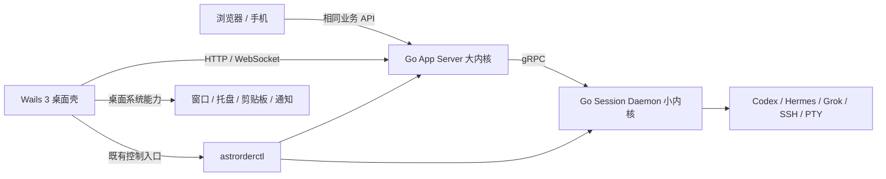

# 星序 Wails 3 桌面壳迁移实施与验收规范

**日期：** 2026-10-12

**状态：** 方案已编写，尚未实施 Wails 迁移。

**源码基线：** `da2676b23613076879480f1923cdbc42f7c85b9a`（master）。

**目标：** 使用最新 Wails 3 与配套依赖完整替换 Electron 桌面壳，复用 React 前端和 Go 大小内核，交付功能等价、会话连续、可安装升级的 Windows 客户端。

**执行方式：** 默认在主会话连续实施，先贯通实际使用流程，再集中回归和审查。阶段用于组织工作，不将最终交付缩减为首页展示或原型。

> 本文仅制定迁移方案，不代表已完成版本升级、Wails 实现或验收，也不授权生产切换、重启内核、提交或推送。后续执行以用户当时授权及仓库 AGENTS.md 为准。

## 1. 最终状态与架构边界



必须保持以下约束：

1. 桌面壳、大内核、小内核是三个独立进程和失败域；Wails 的 Go 服务仅提供桌面系统能力，不将业务服务或 Session Daemon 嵌入窗口进程。
2. React、Mantine、聊天、监控、黑板、终端、侧栏等业务 UI 复用；HTTP/WebSocket 业务契约保持浏览器可用，不全面改成 Wails Go 绑定。
3. 小内核会话托管、WAL、模型执行器与进程所有权保持原实现；不新建第二套托管器，不让 Wails 的退出清理遍历并终止全部子进程。
4. 继续使用 `%LOCALAPPDATA%/Astrorder` 持久状态及原安装目录。WebView2 用户配置放入明确的桌面子目录；候选开发版使用隔离状态目录、端口及 WebView2 profile。
5. 保留用户连接、偏好、附件、模型绑定、审批与历史可见性；Agent 历史和用量遵循既有权威来源与 API/event 规则，不因桌面迁移增加原生数据库统计兜底。
6. 最终运行与安装不依赖 Electron 或 Node.js；Node.js 可以保留为前端开发、构建和验收工具。Hermes 原生 Python 插件、llama.cpp、Git、SSH 等外部运行时按原职责保留，不因迁移重写。
7. 迁移期 Electron 可作为对照和回滚版本；Wails 正式替换验收通过后清退 Electron 的活动源码、依赖、入口及打包配置，历史通过 Git 基线追溯，不在工作树保留第二套旧桌面实现。
8. 首期交付 Windows 安装器 EXE。macOS、Linux 桌面发布及移动端原生壳不在本次承诺范围；现有浏览器/手机访问与 Linux 远程 helper 必须继续可用。

## 2. 已核实基线与待验证项

### 2.1 现有实现

| 责任 | 已存在文件 | 迁移要求 |
| --- | --- | --- |
| 桌面主进程、托盘、服务控制、窗口、通知、剪贴板 | `desktop/main.js` | 按实际处理分支逐项迁移 |
| 主页面桌面接口 | `desktop/preload.js` | 保持 `astrorderDesktop` 产品接口或集中适配调用者 |
| 图片预览接口及页面 | `desktop/preview-preload.js`、`desktop/image-preview.html` | 保留预览、复制、保存及窗口交互 |
| 启动与状态页 | `desktop/service-startup.js`、`desktop/service-status.html`、`desktop/service-status.js`、`desktop/splash.html` | 保留启动顺序、失败反馈与服务管理入口 |
| 独立开发入口 | `desktop/dev-main.js` | 新 Wails 开发入口必须隔离生产数据和服务 |
| 构建、资产清单、包内校验 | `desktop/package.json`、`desktop/stage-go-artifacts.js`、`desktop/verify-desktop-archive.js` | 用独立于 Electron 的构建/安装流程承接 |
| 既有桌面测试 | `desktop/service-startup.test.js`、`desktop/package-assets.test.js`、`desktop/stage-go-artifacts.test.js`、`desktop/verify-desktop-archive.test.js` | 保留行为断言，替换框架专属断言 |
| 前端构建与依赖 | `frontend/package.json`、`frontend/package-lock.json` | 升级并锁定，保留浏览器构建 |
| 后端构建与工具检查 | `scripts/build-go.ps1`、`scripts/build-go.sh` | 统一工具链版本与产物校验 |
| 内核控制实现 | `app-server-go/cmd/astrorderctl/`、`app-server-go/internal/lifecycle/` | 复用控制入口及权威状态，不重写生命周期 |

当前 Electron 清单为 `electron ^44.3.0`、`electron-builder ^26.0.12`；它们是待替换基线，不是 Wails 目标依赖。前端表中“当前”指 package.json 声明，实际安装版本仍需读取锁文件。

已核实调用者包括：`frontend/src/api/client.ts`、`frontend/src/main.tsx`、`frontend/src/domain/notifications.ts`、`frontend/src/features/services/DesktopSettingsPage.tsx`、`frontend/src/features/chat/ChatComposer.tsx`、`frontend/src/features/chat/ChatPage.tsx`、`frontend/src/features/monitor/MonitorPage.tsx`、`frontend/src/features/sidecar/viewers/filetree/FileTreeViewer.tsx`。

### 2.2 不得被迁移掩盖的现状

- Go 后端主要实现已迁移，源码检查点已推送；这不等于旧迁移所有安装、交互与跨环境验收已经完成。
- 本轮提交前相关 App 包、Hermes adapter、contracts 测试及 Go vet、App 构建通过；前端全量 418 项测试和生产构建通过。这些是旧栈基线，不能写成 Wails 验收结果，也不是未来必须维持的测试数量。
- Windows 生命周期测试曾出现 `CREATE_BREAKAWAY_FROM_JOB` 拒绝访问；审查环境还出现 PowerShell ACL 测试失败。必须区分源码回归与环境限制，不删除独立进程保护使测试变绿。生产启动应使用受支持的控制/系统启动路径，不将临时运维 overlay 固化为产品方案。
- 本地 R2T2 生产流式 HTTP/WebSocket 链路已验证并按用户要求启用；新 WebView2 的真实麦克风、长录音、权限与音频采样链路仍需单独验收。
- 分叉、原生接管、完整跨环境矩阵等旧问题以当时源码复核，分别登记。与壳无关的缺口不自动阻塞开发；阻塞本次必需使用流程的问题必须在发布前解决或取得明确范围调整。

实施前从基线提取完整 bridge、调用者、启动/退出、安装/升级、资产清单和测试断言，形成版本化迁移矩阵。新增功能同步进入矩阵，不能删旧源码后把原有要求一起删掉。

## 3. 依赖必须采用最新版本

### 3.1 选型与锁定规则（必需）

- **实施时重新查询官方最新版本，并升级到最新可验证的兼容组合。** 本文日期快照不是长期版本上限，不以“当前能跑”为理由沿用过时依赖。
- Wails 必须使用 **v3 最新正式发布**；尚无 v3 正式版时使用 **最新 v3 官方预发布 tag**。不能用 GitHub `/releases/latest` 的稳定版结果替代 v3 查询，也不使用未发布分支 HEAD 冒充最新 release。
- Wails Go 模块、`wails3` CLI 和 `@wailsio/runtime` 使用匹配 release。核对框架模板和 runtime 版本契约后锁定，不混用不同 Beta 版本。
- 一般 Go/npm 依赖采用最新稳定版，包括主版本升级；迁移 API、配置和测试来满足最新版本。除 Wails 3 必需预发布外，不默认选择其他库的 next/canary。
- Go 编译器采用最新稳定版本；当前查到 1.27.2，实施时同步四个模块和构建版本检查。`go` 指令表示最低版本，不足以证明实际编译器；记录 `go version` 和 `go version -m`。
- Node.js 构建工具默认采用最新稳定 Current 版本；本文查到 26.11.1。若使用最新 LTS 24.21.0，必须记录这是显式兼容选择及理由，不能把 LTS 称为全局最新版。Node 类型包与所选构建主版本核对。
- 每个直接依赖记录精确版本、查询日期、官方来源、兼容限制和最终选择。Go 使用 go.mod/go.sum，npm 使用精确直接版本及 package-lock.json；正式安装执行 `npm ci`。CI 不使用无版本 `@latest` 动态解析。
- 查询命令中可以用 `@latest`，产物与构建脚本必须固定解析结果。锁定之后，除非发现缺陷或用户明确要求，不因每日新发布无边界重复升级；集中交付前复核安全修复及过期情况。
- 配套依赖必须作为组合核验。例如 `modernc.org/sqlite v1.60.1` 的官方 go.mod 指定 `modernc.org/libc v1.77.1`；虽然 libc 最新为 v1.78.0，不能独立强升破坏 SQLite 配套要求。记录此唯一明确的当前候选差异，后续查询 SQLite 新版后再判断。
- 主版本升级存在明确阻塞时，记录触发场景、失败输出、上游 issue、替代路线和临时版本。不能默默降级、忽略 peerDependencies，或把兼容豁免当成已满足“最新”。
- 对完整解析图执行漏洞与 retraction 检查，核对模块继任路径；同一路径的 latest 可能多年未更新。旧间接依赖有配套约束时记录原因，不随意替换底层驱动来追逐日期。

### 3.2 2026-10-12 官方版本快照

以下是联网查询结果，不代表已安装或通过本项目验证。

| 工具 / 新依赖 | 当前基线 | 当日最新候选 | 来源 / 要求 |
| --- | --- | --- | --- |
| Wails Go 模块和 wails3 CLI | 未引入 | `v3.0.0-beta.28` | Go proxy 与 GitHub Releases 一致，发布于 2026-10-05 |
| `@wailsio/runtime` | 未引入 | `3.0.0-beta.28` | npm latest，与 Wails tag 匹配 |
| Go | 模块/构建脚本 1.27.0 | `1.27.2` | go.dev 稳定版清单 |
| Node.js | 开工时读取实际环境 | `26.11.1` | nodejs.org Current；最新 LTS 为 24.21.0 |

Wails beta.28 模块最低 Go 为 1.25.0；采用 Go 1.27.2 仍需实际编译验证。beta.28 发布记录包含 Windows WebView2 恢复、回调存活和资源清理修复，不能因为 Beta 标签而停留在更老版本。

### 3.3 前端全部直接依赖候选

同一组的联动升级必须一起验证，尤其 React/类型包、Mantine 三包、Vite/plugin、Vitest/jsdom、PWA 和 TypeScript。

| 依赖 | 当前声明 | 当日 npm latest |
| --- | --- | --- |
| `@json-render/core` | ^0.20.0 | 0.21.0 |
| `@json-render/react` | ^0.20.0 | 0.21.0 |
| `@mantine/core` | ^9.6.0 | 9.7.2 |
| `@mantine/hooks` | ^9.6.0 | 9.7.2 |
| `@mantine/notifications` | ^9.6.0 | 9.7.2 |
| `@monaco-editor/react` | ^4.7.0 | 4.7.0 |
| `@samasante/liquid-glass` | ^0.1.1 | 0.1.1 |
| `@tabler/icons-react` | ^3.46.0 | 3.49.0 |
| `@tanstack/react-query` | ^5.102.8 | 5.104.2 |
| `@tanstack/react-virtual` | ^3.14.10 | 3.14.17 |
| `@types/three` | ^0.185.4 | 0.186.0 |
| `@xterm/addon-fit` | ^0.11.0 | 0.11.0 |
| `@xterm/xterm` | ^6.0.0 | 6.0.0 |
| `mermaid` | ^12.0.0 | 12.1.0 |
| `motion` | ^13.2.0 | 14.1.0 |
| `react` | ^19.2.8 | 19.3.0 |
| `react-dom` | ^19.2.8 | 19.3.0 |
| `react-markdown` | ^10.1.0 | 10.1.0 |
| `react-router-dom` | ^7.18.3 | 7.18.4 |
| `remark-gfm` | ^4.0.1 | 4.0.1 |
| `three` | ^0.186.0 | 0.186.1 |
| `zod` | ^4.5.4 | 4.6.6 |
| `zustand` | ^5.0.15 | 5.0.15 |
| `@playwright/test` | ^1.63.0 | 1.64.0 |
| `@testing-library/jest-dom` | ^7.0.1 | 7.0.1 |
| `@testing-library/react` | ^16.3.3 | 16.3.3 |
| `@testing-library/user-event` | ^14.6.7 | 14.6.7 |
| `@types/node` | ^24.13.3 | 26.6.5 |
| `@types/react` | ^19.2.18 | 19.3.0 |
| `@types/react-dom` | ^19.2.4 | 19.3.0 |
| `@vitejs/plugin-react` | ^6.1.0 | 6.1.2 |
| `jsdom` | ^29.1.1 | 30.1.2 |
| `oxlint` | ^1.79.0 | 1.87.0 |
| `typescript` | ~6.0.2 | 7.0.2 |
| `vite` | ^8.2.2 | 8.3.4 |
| `vite-plugin-pwa` | ^1.3.0 | 2.0.0 |
| `vitest` | ^4.1.11 | 5.0.4 |

Vite/plugin-react 最新版要求 Node `^20.19.0 || >=22.12.0`；Vitest 5.0.4 要求 `^22.12.0 || ^24.0.0 || >=26.0.0`。TypeScript 7、Vitest 5、motion 14、PWA 2 是明确需要处理的主版本升级，不把更新清单等同兼容性已验证。

### 3.4 既有 Go 依赖候选

此表覆盖现有三个 Go 模块 go.mod 的外部依赖去重清单；引入 Wails 后新增的完整传递图需重新生成，不能把本表当作最终全图。

| 模块 | 当前选择 | 当日同路径最新 |
| --- | --- | --- |
| `github.com/coder/websocket` | v1.8.15 | v1.8.15 |
| `github.com/dustin/go-humanize` | v1.1.0 | v1.1.0 |
| `github.com/goccy/go-yaml` | v1.19.2 | v1.19.2 |
| `github.com/google/uuid` | v1.6.0 | v1.6.0 |
| `github.com/mattn/go-isatty` | v0.0.24 | v0.0.24 |
| `github.com/ncruces/go-strftime` | v1.1.0 | v1.1.0 |
| `github.com/pelletier/go-toml/v2` | v2.4.3 | v2.4.3 |
| `github.com/remyoudompheng/bigfft` | v0.0.0-20230129092748-24d4a6f8daec | v0.0.0-20230129092748-24d4a6f8daec |
| `golang.org/x/net` | v0.61.0 | v0.61.0 |
| `golang.org/x/sys` | v0.49.0 | v0.49.0 |
| `golang.org/x/text` | v0.43.0 | v0.43.0 |
| `google.golang.org/genproto/googleapis/rpc` | v0.0.0-20261005182115-fad411399dd8 | v0.0.0-20261005182115-fad411399dd8 |
| `google.golang.org/grpc` | v1.84.0 | v1.84.0 |
| `google.golang.org/protobuf` | v1.36.12 | v1.36.12 |
| `modernc.org/libc` | v1.77.1 | v1.78.0（SQLite 配套约束见 3.1） |
| `modernc.org/mathutil` | v1.7.1 | v1.7.1 |
| `modernc.org/memory` | v1.12.1 | v1.12.1 |
| `modernc.org/sqlite` | v1.60.1 | v1.60.1 |

Buf、Protobuf 生成器、安装器工具及新增 Windows 系统库也必须在实施时查询最新版本，核验生成兼容后更新版本检查；本文未查询到的工具不能自行标为最新版。

### 3.5 可重复查询方式

以下为后续实施查询指引，本次仅查询元数据，未执行安装/升级：

```bash
# 在有 go.mod 的项目模块中执行；禁止查询时改写依赖。
go list -m -json github.com/wailsapp/wails/v3@latest
go list -m -u -mod=readonly -json all
npm view @wailsio/runtime dist-tags --json
npm view react version
npm view typescript version
```

- Wails v3 版本及时间：`https://proxy.golang.org/github.com/wailsapp/wails/v3/@latest`。
- Wails release 清单（含预发布）：`https://api.github.com/repos/wailsapp/wails/releases`；按 v3 tag、非 draft、语义版本排序选择，核对发布日期。
- npm 每个包：`https://registry.npmjs.org/<编码后的包名>/latest`，scope 内斜杠编码为 `%2f`；同时读 engines 和 peerDependencies。
- Go 依赖：`https://proxy.golang.org/<转义模块路径>/@latest`，随后读候选 `.mod` 和 retraction；大写路径须按 Go proxy 规则转义。
- Go 稳定版：`https://go.dev/dl/?mode=json`。
- Node Current/LTS：`https://nodejs.org/dist/index.json`。

## 4. 桌面能力迁移矩阵

每项完成后记录实现文件、自动检查、真实交互证据和遗留限制，状态先保持 `TODO`。

| ID | 现有能力与调用契约 | Wails 目标及验收重点 | 状态 |
| --- | --- | --- | --- |
| W01 | `status()`、`run(target, action)` | 继续通过 ctl；状态页专属服务控制权限、参数白名单、结构化错误、超时和重复操作保护 | TODO |
| W02 | `getStartupSettings()`、`setStartupEnabled(boolean)` | 正式安装路径开机启动；开发版隔离；保留用户原选择和快捷方式语义 | TODO |
| W03 | `minimize()`、`maximize()`、`close()`、`isMaximized()` | 最小化/最大化切换及返回值；关闭隐藏至托盘；多屏 DPI、恢复和窗口尺寸 | TODO |
| W04 | 托盘、双击打开、单实例、第二次启动 | 菜单状态与真实内核一致；第二实例唤醒既有窗口，不重复启动服务 | TODO |
| W05 | `notify({title, body, tag})` | 原生通知、点击恢复窗口、焦点反馈；尊重系统权限与通知设置 | TODO |
| W06 | `setClipboardFiles(paths)` | Windows 原生文件剪贴板，保留多文件、中文/空格/分号路径；错误不伪报成功 | TODO |
| W07 | `getPathForFile(file): string` 与附件 `source_path` | 改为可信原生文件选择/拖入事件提供路径，必要时统一异步接口并更新全部调用者；文件字节与路径分别验证 | TODO |
| W08 | `openPreview({images,index})` | 多图索引、主窗口关联、关闭恢复焦点；鉴权图片可读、跨来源拒绝 | TODO |
| W09 | `astrorderPreview.onData/resolve/close/copy/save` | 预览事件、图片剪贴板、PNG/JPEG 保存和取消；预览窗口无服务控制权限 | TODO |
| W10 | 启动 splash、状态页、服务日志和令牌复制 | 内核不可用时仍可管理服务；凭据不进入日志/URL/产物；原有显式复制入口保留 | TODO |
| W11 | 主页面鉴权、相对 API、WebSocket | 新 WebView origin 下认证、刷新/重连、流式事件及终端全链路；浏览器端继续可用 | TODO |
| W12 | 外链、窗口导航、刷新、开发工具 | 外链走系统浏览器；未知导航拒绝；Ctrl+R/F5、开发工具快捷键与输入控件不冲突 | TODO |
| W13 | 中文输入、终端、富文本/Monaco 与粘贴拖放 | IME 合成期间不误发送；终端 Ctrl+C 等按原语义；本地/WSL/SSH 附件上下文不丢失 | TODO |
| W14 | 麦克风与本地 R2T2 流式听写 | 权限、设备切换、取消、重连、实际首字与完整结果；长录音和后台/恢复行为 | TODO |
| W15 | 安装/覆盖升级/卸载、资产交付 | EXE 安装器，数据路径不变；完整 helper/plugin/前端校验；活动 daemon 保持原进程 | TODO |
| W16 | 退出、重开、App 独立更新、崩溃恢复 | 保留现有生命周期语义及后台会话连续性，不让 WebView 进程拥有托管 Agent 生命周期 | TODO |

### 4.1 原始文件路径必须专门处理

浏览器 File 不保证暴露原始路径，Wails 绑定也不能自动接受任意 JS File 并还原路径。现有 `uploadAttachment` 同步取得字符串；不能用返回 Promise 的 Go 绑定直接替换，也不能把 `File.name` 拼成绝对路径。

优先用 Wails 支持且经版本验证的原生选取/拖放事件，将路径和对应文件关联；必要时把上传调用链统一改为 await，并保持普通浏览器仅上传字节的合法路径。上传结果分别核对内容、名称、源路径和会话/连接上下文；图片剪贴板没有原始路径时保持缺省，不伪造。

### 4.2 页面来源与权限

优先验证保持 App HTTP origin 的承载方式，以复用相对 API、现有会话 cookie 和 WS。必须查证 beta.28 对远程 URL/同源代理、runtime 注入和 Go 绑定的实际支持，不能假定外部页面自动获得 Wails 绑定。

若使用 Wails 自有 origin，采用明确的同源代理或集中 API base/认证适配，覆盖 `/api/v1`、事件 WS、终端 WS、音频 WS、附件和原始文件响应。只允许明确本机服务目标，不做任意 URL 代理；保留 WS upgrade、流式响应、取消和 backpressure。禁止通过关闭浏览器安全策略、全域 CORS、令牌 URL 参数或持久前端明文 token 绕过集成问题。

需要 privileged binding 的页面限定在内建可信状态页/主页面范围；预览数据和外部链接不得获得任意文件、服务控制或凭据访问。窗口级/来源级权限如果框架不足，使用明确受限的服务门面补齐，不能只在前端隐藏按钮。

该承载决策必须在首个集成阶段以实际 HTTP、WS、绑定调用和拒绝测试证明，再展开所有功能迁移。

## 5. 启动、关闭与内核操作语义

| 动作 | 当前可见行为 | Wails 必须保留的结果 |
| --- | --- | --- |
| 打开客户端 | 单实例；先 daemon start，再 App start；失败显示状态页 | 顺序等待权威 readiness，已运行则接入，不替换既有进程 |
| 点击关闭按钮 | 拦截 close 并隐藏窗口，关闭预览 | 客户端留托盘，大小内核继续运行 |
| 托盘“退出客户端” | 停大内核后退出壳，小内核继续运行；App 停止失败时明确报错 | 保持该语义，不误写成“退出后两个内核均常驻” |
| 重开客户端 | 恢复 UI，启动/接入 App | daemon 和托管会话连续；历史、实时输出及终端按原协议重连 |
| 大内核停止/重启/替换 | ctl 管理 App | 不触发 daemon 或 Agent/SSH/PTY 停止；独立验证进程身份 |
| 小内核停止/重启 | 权威状态读取及活动会话确认 | running/waiting_approval 存在时必须用户明确同意；读取失败/歧义按存在活动会话处理 |
| 桌面进程崩溃或 WebView 恢复 | 需实际验收 | 不按退出回调隐式停止 daemon；窗口恢复失败有可读状态，避免无限重启 |

关闭/退出/升级各自测试，不能从“三个 EXE”推导会话一定存活。Windows 无窗口启动沿用原生受支持路径，保留句柄/进程身份与独立性保护；不新增 Python/PowerShell 业务运行时。若个别 Windows API 必须补齐，优先 Go 系统接口并集中封装。

## 6. 实施阶段与退出检查

以下目录为**拟新增**，不表示文件或命令当前已存在：`desktop-wails/`（独立 Go module）、`frontend/src/desktop/`（统一桥接适配）、`scripts/desktop/`（独立构建/安装验证）。最终是否将新壳归并回 `desktop/` 在清退阶段统一处理，不能长期维护两套壳。

### P0：冻结基线并锁定最新依赖

- 前置：刷新 git HEAD/status；检查其他会话修改，保留无关文件。
- 交付：版本化迁移矩阵、旧能力和生命周期清单、依赖查询证据、精确候选组合、隔离路径方案。使用 `git show <基线>:<文件>` 回看旧实现。
- 实施：更新 Go/构建检查，配套升级前端，创建 Wails 模块；CLI、Go/runtime 同 tag；检查生成器/安装工具最新兼容版本。
- 退出：从锁文件可重现安装；当前前后端测试/类型/构建通过；新增故障归因清楚。保存环境失败，不将过滤测试写成全通过。
- 停止条件：依赖解析冲突、被撤回版本、缺失受支持编译器、工具链与声明不一致。先解决，不跳过校验。

### P1：Wails 与真实 Go 服务贯通

- 前置：P0 依赖组合和隔离状态就绪。
- 交付：可启动开发客户端、独立内核接入、splash/状态页、鉴权、可信 bridge、主 UI、事件与终端 WS。
- 实施：证明 4.2 的 WebView 承载方式；通过 ctl 顺序启动，实际创建隔离会话、发送受控任务、观察实时输出、完成状态与历史读回。
- 退出：真实 Wails WebView 完成基本流程；刷新和重连不重复发消息；无假响应，无生产配置引用，后台进程清理只作用于隔离实例。
- 停止条件：只有静态页面、缺失 runtime 注入、鉴权/WS 失败、读写到生产状态目录、进程随窗口错误退出。

### P2：桌面能力完整迁移

- 前置：P1 主流程可用。
- 交付：W01–W14 全部接线，W16 生命周期实现；窗口、托盘、状态/服务控制、开机启动、通知、预览、剪贴板、附件、麦克风均可实际操作。
- 退出：按能力矩阵运行 focused checks 与真实交互；中文 IME、终端输入、带上下文远端附件、本地流式听写实际通过。相关已通过检查无源码变化则复用证据。
- 停止条件：明确功能缺失、权限越界、丢附件路径/会话上下文、数据损坏、未确认命令被自动重发。

### P3：隔离集成验收及安装器

- 前置：P2 核心路径完整；旧缺陷已分清新增/基线/范围外。
- 交付：统一回归结果、独立审查结论、全新候选安装器 EXE、产物 manifest 与 SHA256、隔离安装/覆盖升级/回滚证据。
- 实施：新壳 + 最新前端 + 所有内核/helper 统一构建；从最终目录提取验证产物；在隔离安装位置验证身份、状态和用户选择保留。安装器可使用 NSIS，但不再依赖 Electron Builder 作为发布链。
- 退出：未安装 Electron/Node 的目标运行环境仍可使用客户端；WebView2 检测及缺失时安装/报错路径可用；安装版核心操作和退出重开通过。
- 停止条件：新旧混包、缺失 helper、manifest/hash 不符、安装器指向生产、尚有必需能力未验收。此阶段不要求生产已切换，避免循环门槛。

### P4：授权后的生产切换与清退

- 前置：P3 已通过，取得当时明确生产授权，读取权威 daemon 状态。本文本身不授予授权。
- 交付：正式安装版 Wails、原数据与偏好保留、线上读回、旧 Electron 活动实现清退、更新维护文档与最终报告。
- 实施：保存旧安装器及回滚清单于仓库外；按新安装器受支持流程替换桌面/App，默认保持 daemon 及其 executable 不变。有活动会话时要更新 daemon，先明确说明影响并取得同意，不能偷偷重启。
- 退出：正式客户端聊天/事件/终端/附件/听写成功；确认 daemon PID、创建时间和验证过的 executable 身份保持，受控会话继续输出；最终包无 Electron/旧壳运行依赖。
- 停止/回滚：核心路径失败、会话中断、数据路径分叉或凭据错误时停止扩大变更，恢复旧壳/App；不得为了回滚顺手重启小内核。回滚只替换二进制和前端等已识别资产，不用旧数据库覆盖新用户数据。

## 7. 构建、打包与更新要求

1. 现有 `stage-go-artifacts.js` 已声明 8 个 Windows 程序及 4 个 Linux helper。迁移安装器必须逐项承接清单，再加入 Wails 桌面程序；禁止只打包 UI 和 App。
2. 保留 Codex plugin、Hermes 宿主插件资产、前端 dist 与品牌图标。Go 后端迁移不等于可以删除外部 Agent 插件。
3. 每次正式候选先运行 canonical 前端/Go/Wails 构建，再生成 manifest 和 SHA256。Wails 生成绑定先完成再最终 diff 检查，不把生成格式噪声混入业务改动。
4. Go 发布使用 `-trimpath`；记录各二进制工具链和实际依赖。检查暂存文件、解包文件与构建输出逐字节一致，安装 EXE 另算 SHA256。
5. 开发 profile、调试日志、测试状态/数据库、私有 token、缓存、旧包和 ZIP 不进入安装资产。仅交付用户要求的安装器 EXE。
6. WebView2 使用受支持的 Evergreen 检测/安装策略；记录真实 WebView2 版本。已有运行时不无故重新下载；离线缺失时给出可操作错误，不能承诺断网一定可首次安装。
7. 单二进制自动更新无法覆盖当前多程序安装布局。若引入框架 updater，仅在证明覆盖全部更新单位、回滚、签名/哈希和运行中 daemon 约束后启用；否则交给安装器执行完整更新。
8. 源码可以统一升级并构建新 daemon，但生产 App/桌面发布不能据此自动替换运行中的 daemon。记录版本/协议兼容矩阵及推迟 daemon 更新的事实。

## 8. 验证命令与证据规范

以下现有命令已按仓库 manifest/模块核对。后续阶段执行，不代表本次文档编写运行了这些验收：

```bash
# 在 frontend/ 中执行
npm ci
npm test
npm run lint
npm run build

# 在 desktop/ 中执行；作为旧桌面行为和资产基线
npm test
npm run check

# 分别在 app-server-go/、session-daemon-go/、contracts/ 执行
go test ./... -count=1 -timeout=240s
go vet ./...
go mod verify

# 引入 desktop-wails/ 后在该目录执行
go test ./... -count=1 -timeout=120s
go vet ./...
go mod verify
```

新壳 `wails3` 构建/开发/安装 task 必须从锁定版本 CLI 的 `--help`、生成模板和实际任务清单核验后写入正式脚本；本文不假定尚不存在的 task 名称可运行。构建命令不得使用全局未知版本工具；后续补一个统一的 Windows 构建入口，产物目录显式传递。

每项证据至少包含：源码 revision/必要 diff、依赖锁版本、执行命令及环境、真实 exit code、日志或截图路径、具体行为断言、是否隔离/安装/生产环境、清理结果。截图不包含 token 和私有会话内容。性能比较采用同一页面/会话负载与同样冷热启动条件，记录进程树总占用，不能只比较主 EXE。

建议最终证据报告路径（尚未创建）：`docs/reports/astrorder-wails3-acceptance.md`。测试数量只作为实际运行结果，不写预期固定通过数量。

## 9. 最终验收清单

以下全部未执行，不能因文档完成而勾选。

- [ ] A01 最新版本查询、精确锁定、配套约束和例外证据完整；Wails CLI/Go/runtime 匹配。
- [ ] A02 全新环境可重现构建，前端/四个 Go 模块和资产校验通过；环境失败明确列出并解决发布阻塞。
- [ ] A03 W01–W16 逐项有实现和行为证据，真实 Wails WebView 基本流程贯通。
- [ ] A04 浏览器/手机 API 与 WS 保持可用，主页面/状态页/预览权限隔离，外部内容无 privileged bridge。
- [ ] A05 中文输入、终端快捷键、多屏 DPI、窗口恢复、通知、托盘、单实例及开机启动通过。
- [ ] A06 文件选择/拖入、图片/文件剪贴板、原始路径与远端附件上下文通过，PNG/JPEG 预览保存通过。
- [ ] A07 真实麦克风、本地 R2T2 首字/完整文本、长录音、取消与恢复通过。
- [ ] A08 关闭隐藏、显式退出、重开、App 独立重启及壳崩溃分别验证，daemon/Agent/SSH/PTY 连续。
- [ ] A09 候选安装/覆盖升级/回滚通过，数据和偏好保留，完整产物来源与最终 EXE 哈希可追溯。
- [ ] A10 生产切换有明确授权和真实读回；活动小内核操作遵循 AGENTS.md。
- [ ] A11 Electron 旧壳、活动依赖及构建入口已清退；无临时代理/运维 overlay 成为隐藏运行依赖。
- [ ] A12 最终审查区分实施完成、隔离验收、安装验收和生产验收，遗留项无虚假通过。

只有 A01–A12 达到承诺范围内最终状态，才可报告迁移完成。缺真实交互或安装环境时标为 `BLOCKED/UNVERIFIED` 并保留未完成项；不得以编译通过替代。

## 10. 官方参考与快照来源

- Wails 3 状态与入口：<https://v3.wails.io/>。
- Wails 架构/各平台 WebView：<https://v3.wails.io/concepts/architecture/>。
- Wails beta.28 官方发布记录：<https://github.com/wailsapp/wails/releases/tag/v3.0.0-beta.28>。
- Wails Go 最新元数据：<https://proxy.golang.org/github.com/wailsapp/wails/v3/@latest>。
- Wails runtime：<https://registry.npmjs.org/@wailsio%2fruntime/latest>。
- Go 最新稳定版本：<https://go.dev/dl/?mode=json>。
- Node 发行清单：<https://nodejs.org/dist/index.json>。
- SQLite 配套声明：<https://proxy.golang.org/modernc.org/sqlite/@v/v1.60.1.mod>。
- 其余 Go/npm 版本采用 3.5 的官方路径逐包查询。本文写作日期是快照时间；正式实施须重新查询，不能把本文候选长期称为最新版。

本次仅新增迁移文档，没有修改依赖、应用源码、安装资产或运行中的服务。
