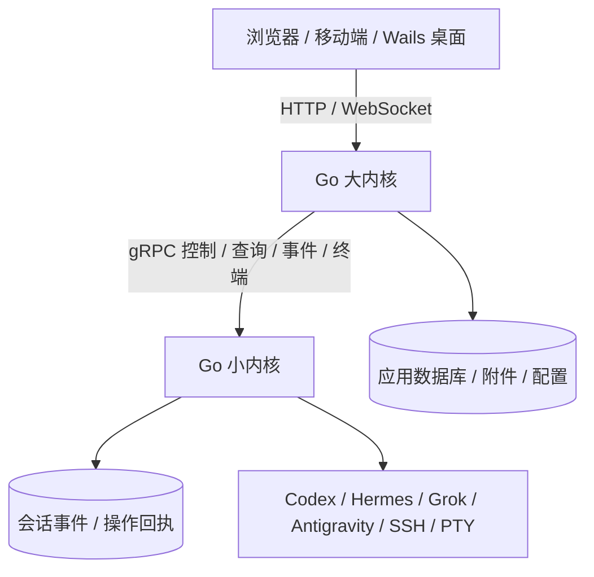

# 大小内核架构

星序使用独立的 Go App Server 和 Go Session Daemon，通过本地 gRPC 通信。React 前端由浏览器、移动端和 Wails 3 桌面客户端共用。

## 职责与代码归属

| 层次 | 职责 | 代码 |
| --- | --- | --- |
| 客户端 | 会话与项目、输入和审批、群聊、文件工作台、运行观察 | `frontend/` |
| 桌面壳 | 原生窗口、托盘、通知、文件选择、图片预览、服务控制入口 | `desktop-wails/` |
| 大内核 | HTTP/WebSocket、鉴权、应用数据、事件投影、群聊编排、文件/Git、黑板与辅助集成 | `app-server-go/` |
| 小内核 | Agent/SSH/PTY 托管、原生控制、执行状态、WAL 与持久操作回执、模型配置执行 | `session-daemon-go/` |
| 内核契约 | protobuf 消息、gRPC 服务、流与操作身份 | `contracts/` |

## 生命周期

大内核与小内核是独立故障域。会话与子进程由小内核托管，大内核停止或更新时，Agent、SSH 和终端进程继续运行；桌面和业务功能不拥有这些进程的生命周期。

大内核恢复后从已确认的事件序列继续消费，结合快照、重放和实时流恢复投影。连接缺失或状态不明确时，不能伪造空闲、成功或重新发送结果不确定的命令。事件与操作的实际结构以 protobuf 和 Go 实现为准，不维护另一套 WebSocket/JSON 内核协议。

控制器使用可执行路径、PID、创建时间和端口归属核验服务身份。大内核可以独立构建、发布和重启。小内核更新由用户通过托盘激活，候选暂存与生效必须区分；维护规则见 [AGENTS.md](../../AGENTS.md)。

## 数据边界

原生会话身份与历史由 Agent 运行时拥有。App 保存产品配置、会话投影、群聊、黑板、附件及投递队列；小内核保存托管与重放所需的运行记录。不要将同一业务数据复制为多个权威写入者。

用户数据库、附件、凭据和正式状态目录与构建输出分离。Go 程序或必需配置缺失时明确报错，不调用旧 Python 服务或旧桌面实现代替。

## 维护入口

- [通信契约](../CONTRACT.md)：HTTP、浏览器事件和内部 gRPC 的来源。
- [小内核维护](../session-daemon.md)：代码归属、配置与验证。
- [安装与更新](../production-deployment.md)：构建产物、安装布局和发布边界。
- [桌面开发](../../desktop-wails/README.md)：Windows/WSL 构建与开发隔离。

历史 Python 内核和 Electron 桌面实现通过 Git 历史追溯。
